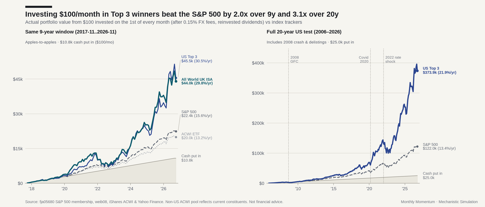
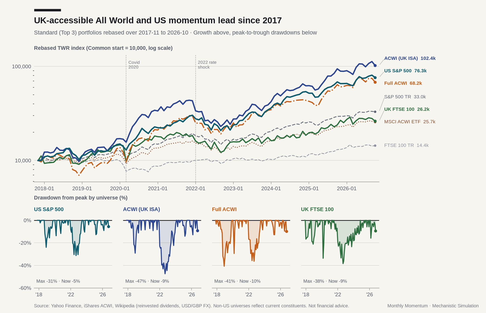
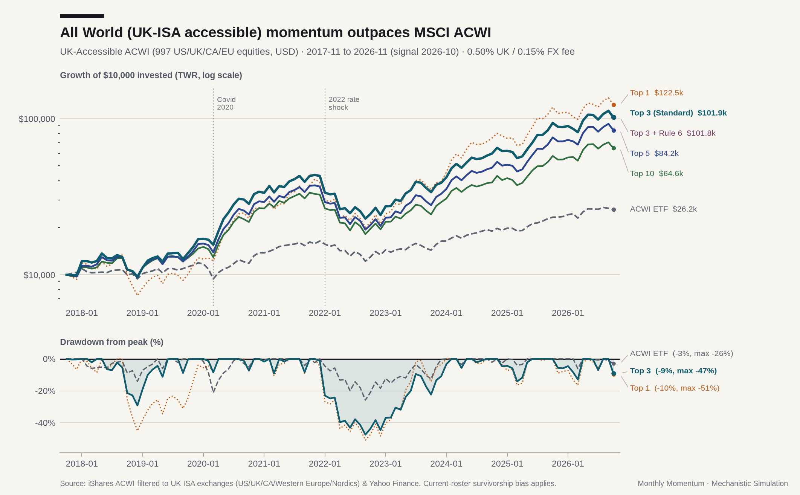
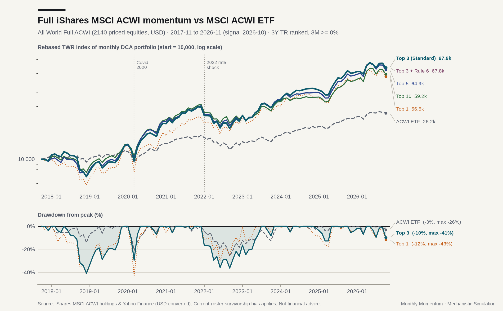
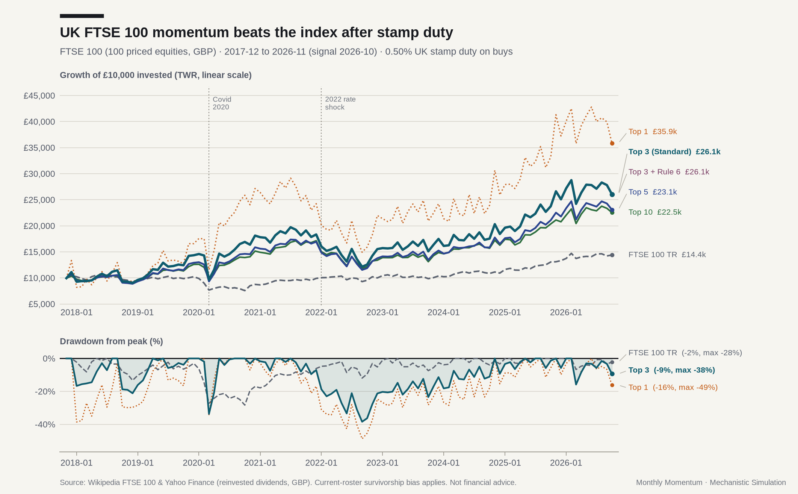
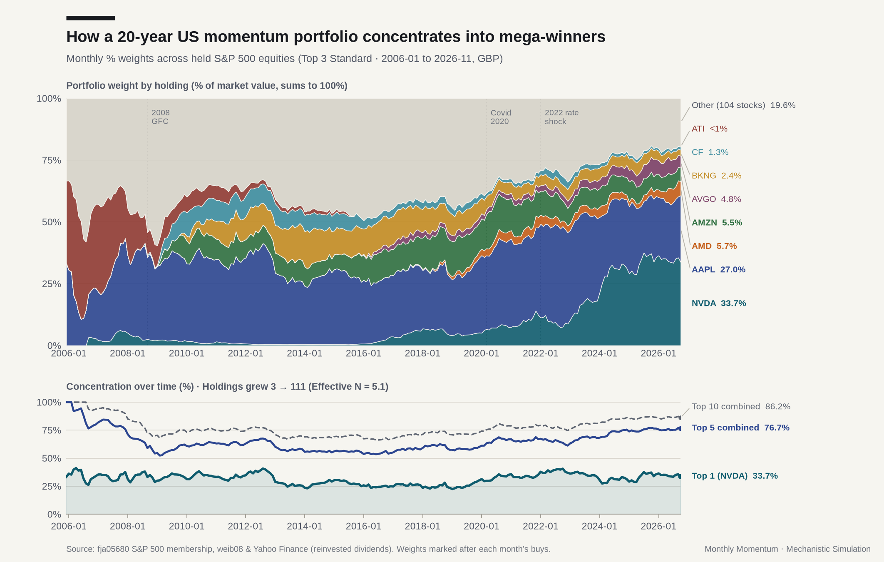
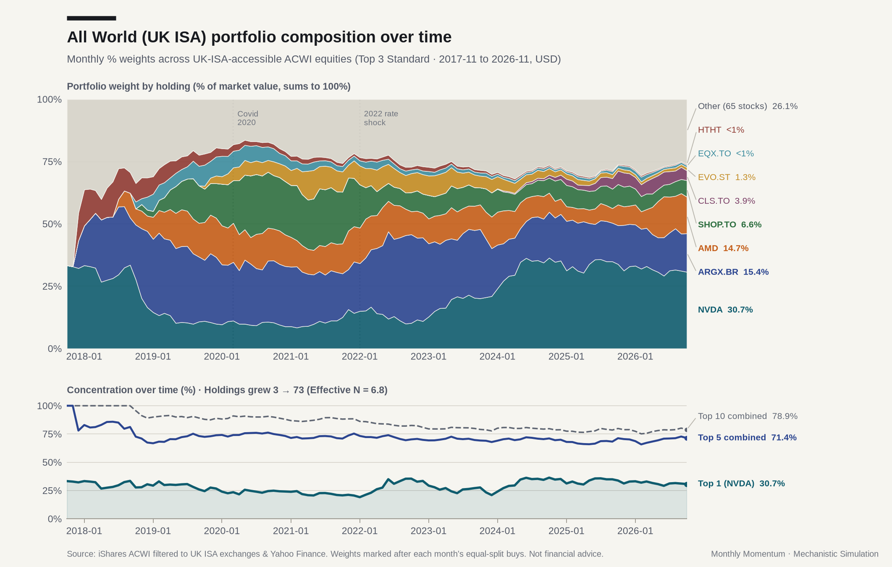
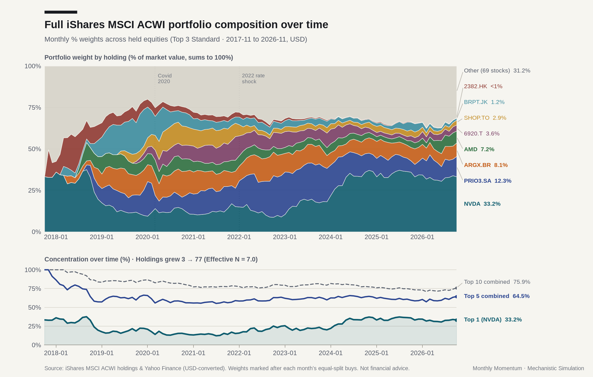
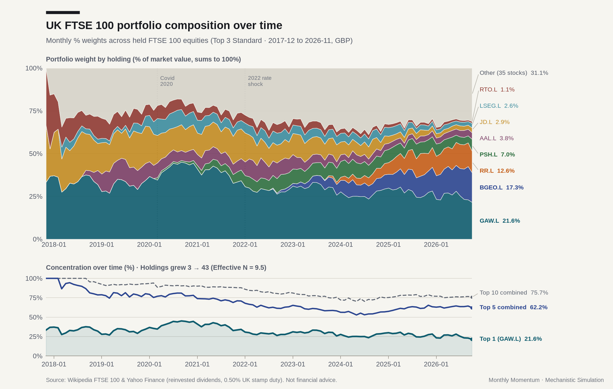
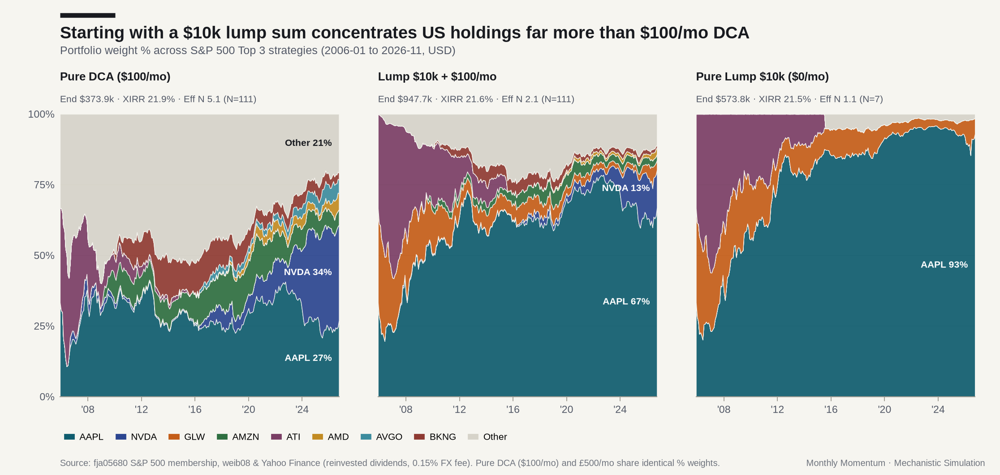

# Monthly Momentum

A simple, rule-based investing system: on the 1st of each month, buy equal amounts of the **top 3 performing shares over the past 3 years** (skipping any that fell over the last 3 months) from a major index or UK-ISA-accessible global universe, then hold without stop-losses.

This repository automatically refreshes market data every month via GitHub Actions, publishes this month's stock picks below, and runs a 20-year survivorship-aware US backtest plus All-World (iShares MSCI ACWI) and UK FTSE 100 tracking offline in [`uv`](https://docs.astral.sh/uv/) Python.

> **Not financial advice.** Everything here is historical research and personal tooling for a Stocks & Shares ISA. See [docs/rules.md](docs/rules.md) for the exact rules and [docs/research.md](docs/research.md) for the underlying evidence.

<!-- AUTO-GENERATED:START -->

## This month's picks

**Latest window:** 2026-11.
**Last updated:** 2026-11-25 (UTC).

| Universe | Window | Top 3 |
| :--- | :--- | :--- |
| All World — UK-accessible | 2026-11 | **LITE**, **MU**, **CVNA** |
| US S&P 500 | 2026-11 | **LITE**, **MU**, **CVNA** |
| UK FTSE 100 | 2026-11 | **BGEO.L**, **PCT.L**, **SMT.L** |
| All World — Full ACWI | 2026-11 | **LITE**, **2059.TW**, **MU** |

[See the rankings and returns](#latest-pick-details).
For monthly alerts, choose **Watch → Custom → Releases** on GitHub.

## At a Glance: Why This Works (and the Catch)



- **The edge (`$100/month`):** Over the shared 9-year global window, `$100/mo` grew to **$44,025** (29.8%/yr) in **All World (UK ISA)** vs **$22,416** (15.6%/yr) in an S&P 500 tracker (**2.0x**) and **$19,959** (13.2%/yr) in an MSCI ACWI ETF. Over the full survivorship-aware **20-year US stress test** ($25,000 put in), Top 3 reached **$373,874** (21.9%/yr) vs **$121,970** (13.4%/yr) in the S&P 500 (**3.1x**).
- **Why it works:** Buying current winners and holding without stop-losses lets rare multi-baggers (`AAPL`, `NVDA`, `AMD`, `ARGX.BR`, `GAW.L`) compound uncapped, while small equal monthly buys keep individual losers immaterial.
- **The catch:** Expect stomach-churning drops (**-47%** to **-66%** peak-to-trough), heavy top-5 concentration (**71%–77%** of portfolio value), and multi-year lagging spells (e.g. 2022–2023 drawdowns, or 2009–2018 outside the US). Best run as a **minority satellite slice (e.g., 10–25%)** inside a tax-free Stocks & Shares ISA alongside a core tracker.
- **Monthly DCA vs. Lump Sum:** `$100/mo` and `£500/mo` produce identical `%` portfolio weights and annualized returns (only totals scale). Dropping a `$10,000` lump sum on Day 1 locks `100x` a monthly buy into Month 1's Top 3 — shrinking Effective N to `1.1–2.8` unless phased in or rotated by **Rule 6**.

## Which Option Is Best?

| Strategy Option (Standard Top 3) | Best For | Shared 9Y (`$100/mo`) | Full 20Y (`$100/mo`) | Worst Drop | Verdict |
| :--- | :--- | :---: | :---: | :---: | :--- |
| **All World — UK ISA** (`997` stocks) | UK retail Stocks & Shares ISA | **$44,025** (29.82%) | — | -47.4% | **Best everyday pick** — global breadth, skips inaccessible EM shares |
| **US S&P 500** (`663` stocks) | Maximum historical confidence | $45,536 (30.5%) | **$373,874** (21.94%) | -66.0% | **Most battle-tested** — survivorship-free across 2008 & delistings |
| All World — Full ACWI (`2140` stocks) | Global institutional benchmark | $38,941 (27.23%) | — | -40.7% | Reference only — includes local TW/KR/CN shares |
| UK FTSE 100 (`100` stocks) | GBP-only / lower drawdown | £18,339 (11.71%) | — | -38.4% | Beats FTSE 100 TR, lower growth after 0.50% stamp duty |

> **Why did `All World (UK ISA)` look so much higher than `US S&P 500` in raw headline tables?** Different start years. Over the exact same 9-year window (`2017-11–2026-11`), All World UK ISA (`$44,025`) and US S&P 500 (`$45,536`) delivered nearly identical returns — while the 20-year US figure (`21.9%`) includes the 2008 financial crash and 2010s grind. All World (UK ISA) edges ahead practically by spreading across Europe & Canada with shallower drawdowns.

- **How many stocks per month (`Top 3` vs `Top 5` vs `Top 10`)?** **Top 3** captures most of `Top 1`'s upside without single-stock lottery risk. **Top 5 (`Balanced`)** or **Top 10 (`Cautious`)** spreads buys wider at lower return. See `Balanced (Top 5)` and all variants in Deep Dive 1.
- **Should you use Rule 6 (6/7/8-year faded-winner trim)?** Optional for pure monthly DCA, **essential if starting with a large Day-1 lump sum**: once a stock stays outside the Top 10 for 6/7/8 years, Rule 6 trims 1/3 -> 1/2 -> all and recycles proceeds into fresh leaders (pausing immediately if it re-enters the Top 10).

## How It Works (5 Minutes a Month)

1. **Pick one universe:** Either **All World (UK ISA)** *(best all-rounder)* or **US S&P 500** *(20y survivorship-aware baseline)*.
2. **Read this month's Top 3:** Ranked automatically after month-end by **3-year total return (incl. dividends)**, discarding any stock down over the last 3 months.
3. **Buy equally on the 1st trading day:** Split that month's contribution into three equal fractional buys (even if you already own those stocks).
4. **Hold without stop-losses:** Every stop-loss rule tested destroyed returns by shaking out future multi-baggers (`NVDA` fell −85% after 2008). Only trim via **Rule 6** after 6–8 years outside the Top 10.

## Latest pick details

Computed deterministically from completed data through **2026-10**. Split this month's deposit equally across your chosen universe's **Top 3**.

### All World — UK-Accessible Top 3 (`463` eligible · 2026-11)

| Rank | Ticker | Company | Exchange | 3Y Return (USD) | 3M Return (USD) | UK Access |
| :---: | :--- | :--- | :--- | :---: | :---: | :--- |
| #1 | **LITE** | LUMENTUM HOLDINGS | NASDAQ | +2044.10% | +17.75% | UK ISA (US) |
| #2 | **MU** | MICRON TECHNOLOGY | NASDAQ | +1235.84% | +7.50% | UK ISA (US) |
| #3 | **CVNA** | CARVANA CLASS A | NYSE | +1164.63% | +9.51% | UK ISA (US) |

- **Top 1 (Aggressive):** **LITE** · **Balanced (Top 5):** **LITE**, **MU**, **CVNA**, **PLTR**, **NTRA**

> **Flagged Global Winners Outside UK Retail ISAs (Skipped Here):** #2 `2059.TW` (KING SLIDE WORKS, Taiwan — Taiwan Stock Exchange, `+1295.1%`), #6 `3653.TW` (JENTECH PRECISION INDUSTRIAL LTD, Taiwan — Taiwan Stock Exchange, `+1012.3%`), #7 `3017.TW` (ASIA VITAL COMPONENTS, Taiwan — Taiwan Stock Exchange, `+1008.5%`), #9 `009150.KS` (SAMSUNG ELECTRO MECHANICS, Korea (South) — Korea Exchange (Stock Market), `+910.3%`), #10 `603268.SS` (GUANGDONG SONGFA CERAMICS A, China — Shanghai Stock Exchange, `+882.9%`)

<details>
<summary>Full All World (UK-Accessible) Top 10 for 2026-11</summary>

| Rank | Ticker | Company | Sector | Exchange | 3Y Return (USD) | 3M Return (USD) | Top 3 |
| :---: | :--- | :--- | :--- | :--- | :---: | :---: | :---: |
| #1 | LITE | LUMENTUM HOLDINGS | Information Technology | NASDAQ | +2044.10% | +17.75% | Yes |
| #2 | MU | MICRON TECHNOLOGY | Information Technology | NASDAQ | +1235.84% | +7.50% | Yes |
| #3 | CVNA | CARVANA CLASS A | Consumer Discretionary | NYSE | +1164.63% | +9.51% | Yes |
| #4 | PLTR | PALANTIR TECHNOLOGIES CLASS A | Information Technology | NASDAQ | +1143.99% | +49.61% | No |
| #5 | NTRA | NATERA | Health Care | NASDAQ | +949.66% | +54.73% | No |
| #6 | RVMD | REVOLUTION MEDICINES | Health Care | NASDAQ | +866.21% | +2.02% | No |
| #7 | ECHO | ECHOSTAR CLASS A | Communication | NASDAQ | +599.42% | +15.28% | No |
| #8 | DELL | DELL TECHNOLOGIES INC CLASS C | Information Technology | NYSE | +562.57% | +4.67% | No |
| #9 | LUG.TO | LUNDIN GOLD | Materials | Toronto Stock Exchange | +492.39% | +5.01% | No |
| #10 | CRWD | CROWDSTRIKE HOLDINGS CLASS A | Information Technology | NASDAQ | +466.68% | +31.21% | No |

</details>

### US S&P 500 — Top 3 (`261` eligible of 503 · 2026-11)

| Rank | Ticker | Company | Sector | 3Y Total Return | 3M Price Return |
| :---: | :--- | :--- | :--- | :---: | :---: |
| #1 | **LITE** | Lumentum | Information Technology | +2044.10% | +17.75% |
| #2 | **MU** | Micron Technology | Information Technology | +1235.84% | +7.50% |
| #3 | **CVNA** | Carvana | Consumer Discretionary | +1164.63% | +9.51% |

- **Aggressive (Top 1):** **LITE** · **Balanced (Top 5):** **LITE**, **MU**, **CVNA**, **PLTR**, **ECHO** *(Top 1 historically saw drawdowns up to −76%)*.

<details>
<summary>Full US S&amp;P 500 Top 10 for 2026-11 (Cautious Variant &amp; Rule 6 Watchlist)</summary>

| Rank | Ticker | Company | Sector | 3Y Total Return | 3M Price Return | Top 3 Buy |
| :---: | :--- | :--- | :--- | :---: | :---: | :---: |
| #1 | LITE | Lumentum | Information Technology | +2044.10% | +17.75% | Yes |
| #2 | MU | Micron Technology | Information Technology | +1235.84% | +7.50% | Yes |
| #3 | CVNA | Carvana | Consumer Discretionary | +1164.63% | +9.51% | Yes |
| #4 | PLTR | Palantir Technologies | Information Technology | +1143.99% | +49.61% | No |
| #5 | ECHO | EchoStar | Communication Services | +599.42% | +15.28% | No |
| #6 | DELL | Dell Technologies | Information Technology | +562.57% | +4.67% | No |
| #7 | CRWD | CrowdStrike | Information Technology | +466.68% | +31.21% | No |
| #8 | AMD | Advanced Micro Devices | Information Technology | +412.49% | +6.02% | No |
| #9 | NVDA | Nvidia | Information Technology | +403.31% | +1.94% | No |
| #10 | MRVL | Marvell Technology | Information Technology | +319.42% | +4.71% | No |

</details>

- **UK FTSE 100 Top 3 (2026-11):** **BGEO.L** (Lion Finance Group, `+261.72%` 3Y), **PCT.L** (Polar Capital Technology Trust, `+202.85%` 3Y), **SMT.L** (Scottish Mortgage Investment Trust, `+147.85%` 3Y) — see Deep Dive 3 below.

## Guide to the Charts & Deep-Dive Reports

| Chart File | What It Answers |
| :--- | :--- |
| [`assets/hero_vs_sp500.png`](assets/hero_vs_sp500.png) | **The big picture:** how much `$100/mo` grows to vs. S&P 500 & ACWI trackers |
| [`assets/performance_markets_comparison.png`](assets/performance_markets_comparison.png) | **Head-to-head markets:** US, All World UK ISA, Full ACWI & UK FTSE 100 since 2017 |
| [`assets/performance*.png`](assets/performance.png) | **Variant comparison:** Top 1 / Top 3 / Rule 6 / Top 5 / Top 10 TWR curves + drawdowns |
| [`assets/allocation_*.png`](assets/allocation_sp500.png) | **What you end up owning:** how portfolio `%` weights concentrate over time |
| [`assets/funding_comparison_sp500.png`](assets/funding_comparison_sp500.png) | **DCA vs. Lump Sum:** why dropping `$10k` on Day 1 concentrates holdings far more |



| Universe | Top 3 Picks (`2026-11`) | Window | Top 3 XIRR | Top 3 TWR CAGR | Max Drawdown |
| :--- | :--- | :---: | :---: | :---: | :---: |
| US S&P 500 (`663` stocks) | **LITE**, **MU**, **CVNA** | 2006-01..2026-11 | 21.94% | 19.77% | -66.0% |
| All World — UK-Accessible ACWI (`997`) | **LITE**, **MU**, **CVNA** | 2017-11..2026-11 | 29.82% | 29.45% | -47.4% |
| All World — Full ACWI (`2140`) | **LITE**, **2059.TW**, **MU** | 2017-11..2026-11 | 27.23% | 23.73% | -40.7% |
| UK FTSE 100 (`100`) | **BGEO.L**, **PCT.L**, **SMT.L** | 2017-12..2026-11 | 11.71% | 11.41% | -38.4% |

<details>
<summary>Deep Dive 1 — US S&amp;P 500 (20-Year Survivorship-Aware Backtest, 2006-01..2026-11)</summary>


Monthly £500 DCA simulation across **251** windows (**2006-01** to **2026-11**, `£125,000` invested, `0.15%` US FX fee vs `0.00%` `^SP500TR`):

| Variant | Ending Value | XIRR | TWR CAGR | Max Drawdown | Top Holding (%) | 5Y Rolling Win vs S&P 500 TR |
| :--- | :---: | :---: | :---: | :---: | :---: | :---: |
| Aggressive (Top 1) | £2,230,104 | 23.27% | 20.47% | -66.9% | NVDA (40.1%) | 99.0% (189/191) |
| Standard (Top 3) | £1,869,372 | 21.94% | 19.77% | -66.0% | NVDA (33.7%) | 100.0% (191/191) |
| Standard (Top 3 + Rule 6) | £2,036,495 | 22.58% | 20.22% | -66.0% | NVDA (42.2%) | 100.0% (191/191) |
| Balanced (Top 5) | £1,553,120 | 20.54% | 17.13% | -64.8% | NVDA (34.4%) | 94.2% (180/191) |
| Balanced (Top 5 + Rule 6) | £1,498,362 | 20.27% | 16.87% | -64.8% | NVDA (37.9%) | 94.2% (180/191) |
| Cautious (Top 10) | £1,236,131 | 18.81% | 15.76% | -63.9% | NVDA (36.3%) | 86.4% (165/191) |
| Cautious (Top 10 + Rule 6) | £1,194,711 | 18.55% | 15.53% | -63.9% | NVDA (35.0%) | 84.3% (161/191) |
| *Standard (Top 3) — excl. NVDA* | £1,263,288 | 18.97% | 17.51% | -65.3% | AAPL (39.9%) | 97.9% (187/191) |
| *Cautious (Top 10) — excl. NVDA* | £806,439 | 15.55% | 13.31% | -62.6% | AAPL (24.1%) | 79.1% (151/191) |
| *Standard (Top 3) — excl. NVDA/AMD/AVGO* | £1,083,922 | 17.81% | 16.63% | -65.3% | AAPL (46.6%) | 94.2% (180/191) |
| S&P 500 Total Return (`^SP500TR`) | £609,852 | 13.39% | 11.13% | -50.9% | Cap-weighted | Baseline |

> **Historical Dataset Coverage:** Built from point-in-time S&P 500 membership (`fja05680/sp500` back to 1996 + live Wikipedia updates) and US stock price histories (`weib08/Stocks-Daily-Price` + Yahoo Finance, `663` active and delisted tickers; OTC bankruptcy tickers such as `LEHMQ`, `BSC`, `SIVB`, and `FRC` are absent). See [docs/research.md](docs/research.md).

### Historical Sub-Period Breakdown (XIRR % / Year)

| Period | Top 1 | Top 3 | Top 5 | Top 10 | S&P 500 TR |
| :--- | :---: | :---: | :---: | :---: | :---: |
| First Decade (2006–2015) (2006-01..2015-12) | 18.59% | 16.96% | 14.64% | 12.27% | 10.67% |
| Financial Crisis Era (2007–2012) (2007-01..2012-12) | 19.41% | 16.33% | 12.85% | 9.02% | 7.71% |
| Recent Decade (2016–Latest) (2016-01..2026-11) | 44.82% | 37.76% | 33.33% | 28.24% | 15.37% |

### US Model Portfolio & Rule 6 Faded-Winner Status

- **Active model positions (Standard Top 3 + Rule 6):** `71` ([`data/model_holdings.csv`](data/model_holdings.csv)).
- **Rule 6 Exit Signals this month:** None triggered.

| Ticker | Company | Months Out of Top 10 | Status | Next Rule 6 Check |
| :--- | :--- | :---: | :--- | :---: |
| CME | CME Group | 94m | `rule6_stage2_sold` | 2027-01 |
| NKTR | NKTR | 92m | `rule6_stage2_sold` | 2027-03 |
| CSX | CSX Corporation | 88m | `rule6_stage2_sold` | 2027-07 |
| TTWO | Take-Two Interactive | 85m | `rule6_stage2_sold` | 2027-10 |
| BA | Boeing | 85m | `rule6_stage2_sold` | 2027-10 |

### US S&P 500 — Latest 12 Monthly Windows

| Window | Signal Data | Top 3 (Standard Equal Split) | Top 1 | Ranks 4–10 | Eligible |
| :--- | :--- | :--- | :--- | :--- | :---: |
| 2026-11 | 2026-10 | **LITE** (+2044%), **MU** (+1236%), **CVNA** (+1165%) | LITE | PLTR, ECHO, DELL, CRWD, AMD, NVDA, MRVL | 261 |
| 2026-10 | 2026-09 | **LITE** (+2050%), **PLTR** (+1069%), **HOOD** (+1047%) | LITE | DELL, CRWD, AMD, NVDA, ANET, HPE, P | 186 |
| 2026-09 | 2026-08 | **LITE** (+1590%), **PLTR** (+1144%), **HOOD** (+862%) | LITE | DELL, CVNA, CRWD, NVDA, IBKR, ANET, BNY | 303 |
| 2026-08 | 2026-07 | **WDC** (+1601%), **STX** (+1345%), **MU** (+1066%) | WDC | DELL, HOOD, HWM, FLEX, CRWD, ANET, NVDA | 299 |
| 2026-07 | 2026-06 | **WDC** (+2138%), **APP** (+1902%), **MU** (+1753%) | WDC | STX, LITE, VRT, CVNA, FIX, CIEN, HOOD | 319 |
| 2026-06 | 2026-05 | **CVNA** (+2725%), **APP** (+2351%), **WDC** (+1722%) | CVNA | VRT, LITE, STX, MU, FIX, CIEN, PLTR | 194 |
| 2026-05 | 2026-04 | **VRT** (+2109%), **LITE** (+1770%), **WDC** (+1576%) | VRT | FIX, STX, CIEN, COHR, MU, NVDA, AVGO | 244 |
| 2026-04 | 2026-03 | **VRT** (+1657%), **LITE** (+1201%), **FIX** (+855%) | VRT | WDC, CIEN, STX, COHR, MU, HWM, EME | 223 |
| 2026-03 | 2026-02 | **FIX** (+895%), **WDC** (+865%), **NVDA** (+664%) | FIX | MU, CIEN, STX, HWM, NRG, GE, LRCX | 321 |
| 2026-02 | 2026-01 | **CVNA** (+3844%), **FIX** (+855%), **WDC** (+656%) | CVNA | MU, STX, HWM, RCL, EME, META, LRCX | 320 |
| 2026-01 | 2025-12 | **CVNA** (+8803%), **FIX** (+721%), **WDC** (+625%) | CVNA | AVGO, GE, MU, STX, HWM, LRCX, CEG | 233 |
| 2025-12 | 2025-11 | **APP** (+4060%), **PLTR** (+2146%), **HOOD** (+1240%) | APP | NVDA, AVGO, WDC, STX, GE, HWM, CRWD | 247 |

<details>
<summary>Full US S&amp;P 500 Pick History (251 windows: 2006-01 to 2026-11)</summary>

| Window | Signal Data | Top 3 (Standard) | Top 1 | Ranks 4–10 | Eligible |
| :--- | :--- | :--- | :--- | :--- | :---: |
| 2026-11 | 2026-10 | LITE, MU, CVNA | LITE | PLTR, ECHO, DELL, CRWD, AMD, NVDA, MRVL | 261 |
| 2026-10 | 2026-09 | LITE, PLTR, HOOD | LITE | DELL, CRWD, AMD, NVDA, ANET, HPE, P | 186 |
| 2026-09 | 2026-08 | LITE, PLTR, HOOD | LITE | DELL, CVNA, CRWD, NVDA, IBKR, ANET, BNY | 303 |
| 2026-08 | 2026-07 | WDC, STX, MU | WDC | DELL, HOOD, HWM, FLEX, CRWD, ANET, NVDA | 299 |
| 2026-07 | 2026-06 | WDC, APP, MU | WDC | STX, LITE, VRT, CVNA, FIX, CIEN, HOOD | 319 |
| 2026-06 | 2026-05 | CVNA, APP, WDC | CVNA | VRT, LITE, STX, MU, FIX, CIEN, PLTR | 194 |
| 2026-05 | 2026-04 | VRT, LITE, WDC | VRT | FIX, STX, CIEN, COHR, MU, NVDA, AVGO | 244 |
| 2026-04 | 2026-03 | VRT, LITE, FIX | VRT | WDC, CIEN, STX, COHR, MU, HWM, EME | 223 |
| 2026-03 | 2026-02 | FIX, WDC, NVDA | FIX | MU, CIEN, STX, HWM, NRG, GE, LRCX | 321 |
| 2026-02 | 2026-01 | CVNA, FIX, WDC | CVNA | MU, STX, HWM, RCL, EME, META, LRCX | 320 |
| 2026-01 | 2025-12 | CVNA, FIX, WDC | CVNA | AVGO, GE, MU, STX, HWM, LRCX, CEG | 233 |
| 2025-12 | 2025-11 | APP, PLTR, HOOD | APP | NVDA, AVGO, WDC, STX, GE, HWM, CRWD | 247 |
| 2025-11 | 2025-10 | APP, PLTR, NVDA | APP | HOOD, AVGO, GE, HWM, DASH, WDC, STX | 260 |
| 2025-10 | 2025-09 | APP, PLTR, NVDA | APP | HOOD, VST, RCL, GE, AVGO, HWM, EME | 309 |
| 2025-09 | 2025-08 | PLTR, NVDA, RCL | PLTR | VST, SMCI, AVGO, GE, NFLX, HWM, COIN | 335 |
| 2025-08 | 2025-07 | PLTR, SMCI, NVDA | PLTR | VST, RCL, AXON, COIN, GE, AVGO, CEG | 330 |
| 2025-07 | 2025-06 | PLTR, SMCI, NVDA | PLTR | RCL, VST, AXON, NFLX, COIN, GE, AVGO | 284 |
| 2025-06 | 2025-05 | PLTR, AXON, NVDA | PLTR | VST, NFLX, GE, CEG, HWM, RCL, AVGO | 199 |
| 2025-05 | 2025-04 | PLTR, SMCI, NFLX | PLTR | FICO, HWM, NRG, LLY, TKO, TT, PGR | 166 |
| 2025-04 | 2025-03 | SMCI, PLTR, HWM | SMCI | GE, TPL, LLY, TRGP, NRG, CAH, TKO | 227 |
| 2025-03 | 2025-02 | SMCI, PLTR, HWM | SMCI | LLY, AVGO, GE, META, NRG, RCL, PGR | 175 |
| 2025-02 | 2025-01 | VST, CEG, PLTR | VST | AXON, HWM, AVGO, TPL, ANET, TRGP, GE | 274 |
| 2025-01 | 2024-12 | VST, FICO, NVDA | VST | PLTR, AXON, AVGO, TRGP, HWM, DECK, ANET | 205 |
| 2024-12 | 2024-11 | VST, FICO, HWM | VST | NVDA, TRGP, TPL, AXON, RCL, ANET, PLTR | 340 |
| 2024-11 | 2024-10 | VST, NVDA, FICO | VST | ANET, AVGO, HWM, LLY, TRGP, IRM, BLDR | 295 |
| 2024-10 | 2024-09 | VST, FICO, ANET | VST | AVGO, BLDR, HWM, PHM, TRGP, ERIE, IRM | 388 |
| 2024-09 | 2024-08 | NVDA, LLY, ANET | NVDA | FICO, TRGP, AVGO, BLDR, MPC, HWM, ACGL | 366 |
| 2024-08 | 2024-07 | NVDA, VST, ANET | NVDA | AVGO, TRGP, LLY, MCK, FANG, FICO, HWM | 362 |
| 2024-07 | 2024-06 | NVDA, VST, LLY | NVDA | ANET, AVGO, MCK, TRGP, FICO, PANW, KLAC | 196 |
| 2024-06 | 2024-05 | NVDA, VST, LLY | NVDA | FSLR, ANET, DECK, TRGP, MPC, AVGO, MCK | 282 |
| 2024-05 | 2024-04 | SMCI, NVDA, LLY | SMCI | BLDR, MPC, TRGP, AVGO, MCK, FANG, COP | 297 |
| 2024-04 | 2024-03 | SMCI, NVDA, BLDR | SMCI | LLY, MPC, ANET, TRGP, FANG, AVGO, STLD | 362 |
| 2024-03 | 2024-02 | NVDA, BLDR, ANET | NVDA | LLY, STLD, JBL, NUE, TRGP, MPC, MCK | 388 |
| 2024-02 | 2024-01 | NVDA, BLDR, MPC | NVDA | NUE, STLD, ANET, TRGP, LLY, JBL, IT | 437 |
| 2024-01 | 2023-12 | BLDR, NVDA, FANG | BLDR | LLY, TRGP, NUE, STLD, ANET, JBL, PWR | 416 |
| 2023-12 | 2023-11 | FANG, LLY, MPC | FANG | TRGP, STLD, ANET, PANW, IT, IRM, MCK | 238 |
| 2023-11 | 2023-10 | FANG, MPC, TRGP | FANG | COP, LLY, ANET, HAL, MCK, EQT, ACGL | 69 |
| 2023-10 | 2023-09 | OXY, TRGP, FANG | OXY | MPC, APA, EOG, COP, XOM, SLB, HES | 139 |
| 2023-09 | 2023-08 | DVN, TRGP, OXY | DVN | ON, MPC, FANG, PWR, NUE, LLY, STLD | 356 |
| 2023-08 | 2023-07 | DVN, ON, PWR | DVN | TRGP, NVDA, NUE, FANG, STLD, OXY, MPC | 334 |
| 2023-07 | 2023-06 | PWR, ON, NVDA | PWR | NUE, TRGP, TSLA, EQT, PANW, BBWI, HCA | 300 |
| 2023-06 | 2023-05 | ON, PWR, FSLR | ON | NVDA, HWM, AVGO, LLY, ANET, IT, EQT | 168 |
| 2023-05 | 2023-04 | TRGP, PWR, FSLR | TRGP | NVDA, HWM, ACGL, XOM, FTNT, ANET, AJG | 182 |
| 2023-04 | 2023-03 | ON, MPC, FCX | ON | FSLR, TSLA, STLD, PWR, NUE, MOS, NVDA | 269 |
| 2023-03 | 2023-02 | STLD, TSLA, NUE | STLD | PWR, FCX, ON, URI, NVDA, MOS, MPWR | 179 |
| 2023-02 | 2023-01 | MRNA, STLD, FCX | MRNA | PWR, NUE, ALB, FSLR, NVDA, SEDG, URI | 370 |
| 2023-01 | 2022-12 | MRNA, PWR, STLD | MRNA | BBWI, SEDG, FCX, LLY, DVN, MCK, ETSY | 391 |
| 2022-12 | 2022-11 | ENPH, MRNA, ALB | ENPH | SEDG, PWR, FCX, ON, LLY, NVDA, ETSY | 336 |
| 2022-11 | 2022-10 | ENPH, ALB, DVN | ENPH | PWR, LLY, FCX, DXCM, MOH, MCK, MOS | 181 |
| 2022-10 | 2022-09 | TSLA, ENPH, ALB | TSLA | PWR, ON, MOH, DVN, MCK, AAPL, REGN | 141 |
| 2022-09 | 2022-08 | TSLA, ENPH, ALB | TSLA | PWR, ON, SEDG, AAPL, MPWR, NUE, MCK | 130 |
| 2022-08 | 2022-07 | TSLA, MRNA, ENPH | TSLA | SEDG, PWR, FTNT, GNRC, ALB, MPWR, LLY | 229 |
| 2022-07 | 2022-06 | LLY, MCK, UNH | LLY | AZO, BMY, LKQ, DG, TMUS, HUM, CI | 48 |
| 2022-06 | 2022-05 | ENPH, ALB, KLAC | ENPH | PWR, DVN, MOS, NUE, LLY, MCK, SNPS | 185 |
| 2022-05 | 2022-04 | ENPH, SEDG, FCX | ENPH | TGT, NUE, PWR, MCK, LLY, NEM, MOS | 158 |
| 2022-04 | 2022-03 | ENPH, TSLA, SEDG | ENPH | FCX, PWR, URI, NUE, CF, DE, MCK | 177 |
| 2022-03 | 2022-02 | FTNT, FCX, HWM | FTNT | STX, AMP, AVGO, NUE, BRO, DVN, DE | 226 |
| 2022-02 | 2022-01 | AAPL, KLAC, QCOM | AAPL | AMAT, LRCX, STX, TSCO, LOW, AMP, BRO | 213 |
| 2022-01 | 2021-12 | ENPH, TSLA, NVDA | ENPH | SEDG, AMD, EPAM, LRCX, TER, FTNT, KLAC | 366 |
| 2021-12 | 2021-11 | ENPH, TSLA, NVDA | ENPH | AMD, ETSY, LRCX, FTNT, KLAC, TER, DXCM | 197 |
| 2021-11 | 2021-10 | ENPH, TSLA, GNRC | ENPH | AMD, ETSY, NVDA, DXCM, MPWR, MSCI, PAYC | 276 |
| 2021-10 | 2021-09 | TSLA, ETSY, CMG | TSLA | MPWR, DXCM, MSCI, KLAC, WST, PWR, CDNS | 210 |
| 2021-09 | 2021-08 | ENPH, TSLA, GNRC | ENPH | ETSY, AMD, CMG, WST, FTNT, DXCM, MSCI | 269 |
| 2021-08 | 2021-07 | ENPH, GNRC, AMD | ENPH | DXCM, FTNT, CMG, ZBRA, WST, PAYC, MSCI | 270 |
| 2021-07 | 2021-06 | ENPH, TSLA, GNRC | ENPH | AMD, ETSY, DXCM, LRCX, FTNT, ZBRA, WST | 343 |
| 2021-06 | 2021-05 | WST, FTNT, TER | WST | LRCX, TGT, PYPL, POOL, CRL, KLAC, MSCI | 416 |
| 2021-05 | 2021-04 | GNRC, DXCM, TER | GNRC | WST, FTNT, ZBRA, LRCX, CMG, PYPL, PAYC | 410 |
| 2021-04 | 2021-03 | ETSY, GNRC, CMG | ETSY | PENN, CDNS, ZBRA, FTNT, KLAC, PYPL, LRCX | 362 |
| 2021-03 | 2021-02 | ENPH, TSLA, ETSY | ENPH | DXCM, CMG, CDNS, ZBRA, FTNT, MPWR, PYPL | 309 |
| 2021-02 | 2021-01 | ENPH, TSLA, ETSY | ENPH | DXCM, AMD, CMG, PAYC, NOW, AAPL, ZBRA | 397 |
| 2021-01 | 2020-12 | TSLA, AMD, ETSY | TSLA | PAYC, CMG, NOW, ZBRA, MSCI, FTNT, CDNS | 391 |
| 2020-12 | 2020-11 | ETSY, AMD, PAYC | ETSY | NOW, ZBRA, MSCI, TGT, IDXX, POOL, PYPL | 345 |
| 2020-11 | 2020-10 | ETSY, PAYC, CMG | ETSY | NOW, MKTX, CPRT, POOL, TGT, WST, QCOM | 235 |
| 2020-10 | 2020-09 | DXCM, ETSY, AMD | DXCM | PAYC, NOW, CMG, ADBE, AMZN, MSCI, AAPL | 323 |
| 2020-09 | 2020-08 | AMD, DXCM, NOW | AMD | CMG, PAYC, AMZN, MSCI, WST, PYPL, ADBE | 346 |
| 2020-08 | 2020-07 | DXCM, AMD, PAYC | DXCM | NOW, FTNT, MSCI, CMG, PYPL, AMZN, WST | 349 |
| 2020-07 | 2020-06 | DXCM, PAYC, AMD | DXCM | NOW, FTNT, MSCI, PYPL, MSFT, ADBE, NFLX | 409 |
| 2020-06 | 2020-05 | DXCM, AMD, PAYC | DXCM | NOW, FTNT, MSCI, PYPL, ODFL, CPRT, KEYS | 204 |
| 2020-05 | 2020-04 | AMD, NOW, MSCI | AMD | NVDA, NFLX, MSFT, AMZN, ADBE, KEYS, PYPL | 63 |
| 2020-04 | 2020-03 | NOW, MSCI, NFLX | NOW | MSFT, NVDA, ODFL, SBAC, AMZN, VRTX, PGR | 27 |
| 2020-03 | 2020-02 | PAYC, NOW, MSCI | PAYC | AMD, ADBE, NVDA, MSFT, LRCX, NFLX, ZTS | 80 |
| 2020-02 | 2020-01 | PAYC, AMD, NOW | PAYC | TDG, MSCI, CPRT, FTNT, ADBE, MA, ANSS | 291 |
| 2020-01 | 2019-12 | AMD, NOW, FTNT | AMD | MSCI, NRG, CPRT, ADBE, ZBRA, VRTX, MA | 324 |
| 2019-12 | 2019-11 | AMD, NRG, FTNT | AMD | MSCI, NOW, CPRT, ADBE, ALGN, EW, MA | 328 |
| 2019-11 | 2019-10 | AMD, NRG, CPRT | AMD | KEYS, MSCI, LRCX, CDW, ALGN, NVDA, MU | 249 |
| 2019-10 | 2019-09 | NRG, BA, KEYS | NRG | CPRT, CDW, TTWO, MA, LRCX, NVDA, MSFT | 256 |
| 2019-09 | 2019-08 | AMD, KEYS, NRG | AMD | TTWO, BA, MA, CPRT, ADBE, NVDA, MU | 311 |
| 2019-08 | 2019-07 | AMD, MU, CPRT | AMD | CDNS, KEYS, ADBE, TTWO, IDXX, MA, MSCI | 253 |
| 2019-07 | 2019-06 | AMD, NFLX, MSCI | AMD | PYPL, CSX, KEYS, ADBE, MA, CPRT, ADSK | 284 |
| 2019-06 | 2019-05 | AMD, ALGN, CSX | AMD | PYPL, CPRT, MSCI, IDXX, DHR, TTWO, ADBE | 184 |
| 2019-05 | 2019-04 | AMD, NVDA, ANET | AMD | ALGN, NFLX, MU, KEYS, NTAP, CPRT, MSCI | 347 |
| 2019-04 | 2019-03 | AMD, NVDA, ANET | AMD | MU, ALGN, NFLX, NRG, BA, KEYS, CSX | 400 |
| 2019-03 | 2019-02 | AMD, ANET, BA | AMD | NRG, ALGN, MU, NFLX, NKTR, KEYS, CSX | 281 |
| 2019-02 | 2019-01 | AMD, NRG, ALGN | AMD | NFLX, BA, MU, KEYS, ADSK, NKTR, IDXX | 256 |
| 2019-01 | 2018-12 | NRG, CME, NEM | NRG | AVGO, YUM, NEE, EXC, CNP, AMT, MKC | 56 |
| 2018-12 | 2018-11 | NRG, UNH, BA | NRG | ROL, DHR, CME, HCA, DE, BSX, ZTS | 150 |
| 2018-11 | 2018-10 | TTWO, ISRG, NRG | TTWO | ADBE, NTAP, FTNT, ADSK, PYPL, UNH, ROL | 140 |
| 2018-10 | 2018-09 | AMD, NVDA, ALGN | AMD | NKTR, TTWO, ANET, DXC, AMZN, ISRG, ADSK | 296 |
| 2018-09 | 2018-08 | AMD, NVDA, ALGN | AMD | TTWO, DXC, ANET, AMZN, CPRT, IDXX, ADBE | 305 |
| 2018-08 | 2018-07 | NVDA, AMD, ALGN | NVDA | TTWO, IDXX, AMZN, CPRT, ADBE, NFLX, ISRG | 306 |
| 2018-07 | 2018-06 | NVDA, AMD, ALGN | NVDA | TTWO, NFLX, AMZN, IDXX, ADBE, ISRG, MSCI | 241 |
| 2018-06 | 2018-05 | NVDA, AMD, ALGN | NVDA | TTWO, NFLX, AMZN, ADBE, IDXX, ISRG, MSCI | 212 |
| 2018-05 | 2018-04 | NKTR, NFLX, DXC | NKTR | AMZN, IDXX, ADBE, ISRG, MSCI, BBY, PGR | 122 |
| 2018-04 | 2018-03 | NVDA, NKTR, NFLX | NVDA | ALGN, AMZN, DXC, LRCX, ADBE, AMAT, IPGP | 172 |
| 2018-03 | 2018-02 | NVDA, ALGN, NFLX | NVDA | AMZN, AMD, DXC, ADBE, BA, ISRG, GPN | 221 |
| 2018-02 | 2018-01 | NVDA, AMD, ALGN | NVDA | NFLX, AMZN, DXC, ADBE, BA, ISRG, DHR | 341 |
| 2018-01 | 2017-12 | NVDA, ALGN, NFLX | NVDA | AMZN, DXC, AVGO, GPN, BA, ADBE, STZ | 318 |
| 2017-12 | 2017-11 | NVDA, ALGN, NFLX | NVDA | DXC, AMZN, AVGO, AVY, ADBE, UNH, AOS | 337 |
| 2017-11 | 2017-10 | NVDA, ALGN, DXC | NVDA | AMZN, NFLX, AVGO, EA, LRCX, AMAT, MTD | 278 |
| 2017-10 | 2017-09 | NVDA, AMD, ALGN | NVDA | DXC, EA, AVGO, NFLX, GPN, AOS, LRCX | 275 |
| 2017-09 | 2017-08 | NVDA, DXC, ALGN | NVDA | EA, AVGO, AMD, GPN, NFLX, CHTR, INCY | 250 |
| 2017-08 | 2017-07 | NVDA, AVGO, AMD | NVDA | EA, AMZN, DXC, ALGN, NFLX, INCY, GPN | 288 |
| 2017-07 | 2017-06 | NVDA, AVGO, ULTA | NVDA | DXC, AMZN, EA, EW, ALGN, GPN, DRI | 263 |
| 2017-06 | 2017-05 | NVDA, ULTA, AVGO | NVDA | EA, AMZN, DXC, EW, NFLX, GPN, IDXX | 228 |
| 2017-05 | 2017-04 | AVGO, EA, NFLX | AVGO | AMD, ULTA, DXC, AMZN, EW, IDXX, LRCX | 277 |
| 2017-04 | 2017-03 | NVDA, AMD, AVGO | NVDA | EA, NFLX, ULTA, SWKS, CHTR, AMZN, IDXX | 290 |
| 2017-03 | 2017-02 | NVDA, AVGO, ULTA | NVDA | EA, SWKS, EW, LUV, CHTR, LRCX, ALK | 327 |
| 2017-02 | 2017-01 | NVDA, AVGO, ULTA | NVDA | EA, SWKS, EW, LUV, ALK, DLR, NFLX | 309 |
| 2017-01 | 2016-12 | NVDA, AVGO, LUV | NVDA | ULTA, ALK, NFLX, DLR, MLM, UNH, NOC | 223 |
| 2016-12 | 2016-11 | NVDA, SWKS, LUV | NVDA | MLM, NOC, VMC, UNH, NFLX, ALK, LRCX | 200 |
| 2016-11 | 2016-10 | NVDA, AVGO, SWKS | NVDA | EA, NFLX, STZ, LUV, NOC, EXPE, AMZN | 140 |
| 2016-10 | 2016-09 | NVDA, AVGO, EW | NVDA | EA, SWKS, GPN, STZ, AYI, TSN, AMZN | 232 |
| 2016-09 | 2016-08 | AVGO, NVDA, EW | AVGO | AYI, STZ, EA, SWKS, AMZN, TSN, MNST | 285 |
| 2016-08 | 2016-07 | AVGO, NVDA, GPN | AVGO | EW, STZ, AYI, EA, TSN, VMC, MNST | 282 |
| 2016-07 | 2016-06 | AVGO, NVDA, AYI | AVGO | EA, STZ, GPN, EW, NOC, CNC, TSN | 242 |
| 2016-06 | 2016-05 | AVGO, AYI, NVDA | AVGO | EA, GPN, NFLX, LUV, EW, STZ, SWKS | 340 |
| 2016-05 | 2016-04 | AVGO, LUV, EW | AVGO | STZ, GPN, UAA, BSX, NOC, TSN, NVDA | 322 |
| 2016-04 | 2016-03 | AVGO, SWKS, LUV | AVGO | UAA, STZ, NOC, NVDA, TSN, HUM, GT | 242 |
| 2016-03 | 2016-02 | AVGO, DAL, STZ | AVGO | NOC, TSN, KR, FSLR, HUM, CI, HRL | 119 |
| 2016-02 | 2016-01 | STZ, AVGO, ILMN | STZ | KR, NVDA, EXR, TSN, HRL, FSLR, ADBE | 91 |
| 2016-01 | 2015-12 | NFLX, AVGO, EA | NFLX | DAL, LUV, STZ, ILMN, HBI, KR, BSX | 270 |
| 2015-12 | 2015-11 | NFLX, LUV, DAL | NFLX | EA, STZ, AVGO, HBI, BSX, VRTX, AAL | 265 |
| 2015-11 | 2015-10 | EA, DAL, LUV | EA | HBI, REGN, AAL, STZ, BSX, ORLY, UAL | 171 |
| 2015-10 | 2015-09 | NFLX, EA, DAL | NFLX | LUV, STZ, UAA, RCL, ORLY, SIG, AAP | 111 |
| 2015-09 | 2015-08 | NFLX, DAL, EA | NFLX | STZ, SEE, HCA, UHS, REGN, RCL, UAA | 96 |
| 2015-08 | 2015-07 | NFLX, EA, GILD | NFLX | STZ, REGN, HCA, RCL, UHS, KR, UAA | 217 |
| 2015-07 | 2015-06 | NFLX, EA, GILD | NFLX | REGN, AVGO, SWKS, CI, UAA, SEE, APTV | 151 |
| 2015-06 | 2015-05 | NFLX, STZ, AVGO | NFLX | EA, GILD, SWKS, REGN, HCA, KR, UHS | 172 |
| 2015-05 | 2015-04 | NFLX, STZ, HBI | NFLX | EA, AVGO, SWKS, REGN, FSLR, VRTX, HCA | 259 |
| 2015-04 | 2015-03 | LUV, STZ, HBI | LUV | GILD, REGN, NFLX, SWKS, EA, HCA, AVGO | 210 |
| 2015-03 | 2015-02 | STZ, LUV, GILD | STZ | NFLX, AVGO, BIIB, EA, UAA, KR, HCA | 231 |
| 2015-02 | 2015-01 | STZ, LUV, REGN | STZ | DAL, WHR, NFLX, UAA, HCA, BIIB, AVGO | 195 |
| 2015-01 | 2014-12 | REGN, DAL, MU | REGN | LUV, STZ, STX, WHR, WDC, AVGO, VRTX | 288 |
| 2014-12 | 2014-11 | REGN, MU, DAL | REGN | LUV, STZ, STX, VRTX, WHR, WDC, APTV | 268 |
| 2014-11 | 2014-10 | REGN, MU, GILD | REGN | DAL, URI, STZ, STX, LUV, PHM, WHR | 275 |
| 2014-10 | 2014-09 | MU, URI, STX | MU | REGN, LYB, GILD, LUV, UAA, NFLX, WDC | 167 |
| 2014-09 | 2014-08 | STX, REGN, MU | STX | GILD, STZ, LYB, UAA, LUV, BIIB, WDC | 259 |
| 2014-08 | 2014-07 | REGN, DAL, STX | REGN | GILD, MU, STZ, UAA, LYB, BIIB, WDC | 221 |
| 2014-07 | 2014-06 | MU, DAL, STZ | MU | GILD, STX, LYB, UAA, BIIB, PHM, WMB | 274 |
| 2014-06 | 2014-05 | DAL, STZ, STX | DAL | LYB, MU, VFC, DFS, WDC, SHW, PPG | 240 |
| 2014-05 | 2014-04 | REGN, DAL, STZ | REGN | LYB, VFC, M, SHW, ORLY, LMT, VLO | 280 |
| 2014-04 | 2014-03 | REGN, STX, STZ | REGN | BIIB, DAL, LYB, M, ORLY, WDC, DFS | 215 |
| 2014-03 | 2014-02 | REGN, BIIB, STX | REGN | GILD, STZ, MA, V, LYB, PHM, DAL | 250 |
| 2014-02 | 2014-01 | REGN, BIIB, STX | REGN | GILD, STZ, MA, V, VFC, LYB, HRB | 197 |
| 2014-01 | 2013-12 | STX, BIIB, GILD | STX | MA, V, STZ, DFS, MCO, VFC, LYB | 312 |
| 2013-12 | 2013-11 | REGN, BIIB, STX | REGN | GILD, LYB, STZ, MA, BKNG, VFC, DFS | 317 |
| 2013-11 | 2013-10 | REGN, BIIB, STX | REGN | LYB, GILD, STZ, DFS, MA, GME, SBUX | 250 |
| 2013-10 | 2013-09 | REGN, BIIB, LYB | REGN | GILD, STZ, SBUX, DFS, MA, MCO, BKNG | 260 |
| 2013-09 | 2013-08 | REGN, LYB, GILD | REGN | STZ, BKNG, SBUX, MA, GME, VFC, PVH | 190 |
| 2013-08 | 2013-07 | REGN, LYB, BKNG | REGN | GILD, STX, DFS, STZ, MCO, SBUX, HD | 259 |
| 2013-07 | 2013-06 | REGN, LYB, BKNG | REGN | BIIB, STX, DFS, STZ, MCO, MNST, GILD | 213 |
| 2013-06 | 2013-05 | REGN, BIIB, LYB | REGN | BKNG, DFS, MCO, STZ, STX, GILD, MA | 306 |
| 2013-05 | 2013-04 | REGN, BIIB, DFS | REGN | STZ, CMG, BKNG, MCO, MNST, GILD, SHW | 286 |
| 2013-04 | 2013-03 | BIIB, DFS, STZ | BIIB | CMG, BKNG, SHW, NFLX, FOSL, LEN, SBUX | 314 |
| 2013-03 | 2013-02 | BKNG, CMG, BIIB | BKNG | STZ, NFLX, FOSL, PVH, VLO, SHW, ORLY | 312 |
| 2013-02 | 2013-01 | BKNG, FOSL, CMG | BKNG | BIIB, LEN, CRM, EMN, AN, SHW, SBUX | 303 |
| 2013-01 | 2012-12 | LEN, BKNG, FOSL | LEN | SHW, PPG, CMI, M, SBUX, EMN, FAST | 206 |
| 2012-12 | 2012-11 | BIIB, BKNG, LEN | BIIB | FOSL, DFS, CMCSA, SHW, HD, AZO, CF | 227 |
| 2012-11 | 2012-10 | FOSL, PRGO, LEN | FOSL | EL, DFS, OKE, FAST, WYNN, CMCSA, HD | 224 |
| 2012-10 | 2012-09 | AAPL, EL, EW | AAPL | FOSL, BIIB, OKE, ROST, TDC, AMZN, CRM | 258 |
| 2012-09 | 2012-08 | AAPL, PRGO, EL | AAPL | FOSL, EW, ROST, AMZN, BIIB, OKE, DFS | 278 |
| 2012-08 | 2012-07 | MNST, PRGO, AAPL | MNST | SPG, AIV, ROST, DFS, EW, BIIB, OKE | 147 |
| 2012-07 | 2012-06 | MNST, PRGO, DLTR | MNST | DFS, ISRG, ROST, SPG, LEN, AIV, BIIB | 126 |
| 2012-06 | 2012-05 | CMG, AAPL, SBUX | CMG | PRGO, DFS, ISRG, DLTR, M, ROST, OKE | 126 |
| 2012-05 | 2012-04 | BKNG, FOSL, CMG | BKNG | FFIV, AAPL, EL, DFS, TDC, WYNN, PRGO | 255 |
| 2012-04 | 2012-03 | BKNG, WYNN, TGNA | BKNG | FFIV, CMG, AAPL, ISRG, DFS, IP, SBUX | 298 |
| 2012-03 | 2012-02 | GNW, BKNG, CMG | GNW | FITB, JBL, IP, CBRE, FFIV, F, AAPL | 292 |
| 2012-02 | 2012-01 | BKNG, CMG, F | BKNG | FITB, FFIV, CBRE, SBUX, AAPL, TPR, THC | 256 |
| 2012-01 | 2011-12 | BKNG, CMG, SBUX | BKNG | AAPL, F, FFIV, THC, FTI, KMX, EL | 315 |
| 2011-12 | 2011-11 | CMG, SBUX, M | CMG | FFIV, EL, TDC, CMI, FTI, KMX, CBRE | 213 |
| 2011-11 | 2011-10 | CMG, AN, FFIV | CMG | TDC, CTSH, AAPL, RL, SBUX, TPR, HUM | 138 |
| 2011-10 | 2011-09 | AAPL, AMZN, AZO | AAPL | ORLY, TJX, MA, CMS, BMY, NI, VFC | 38 |
| 2011-09 | 2011-08 | BKNG, CMG, AN | BKNG | AMZN, SBUX, AAPL, AZO, ORLY, WYNN, RL | 54 |
| 2011-08 | 2011-07 | NFLX, CMG, AN | NFLX | AMZN, SBUX, TPR, EL, AAPL, ORLY, RL | 92 |
| 2011-07 | 2011-06 | NFLX, BKNG, FFIV | NFLX | CMG, AN, ORLY, EW, AMZN, TDC, SBUX | 175 |
| 2011-06 | 2011-05 | NFLX, BKNG, CMG | NFLX | EW, AMZN, AZO, ROST, ORLY, NTAP, EL | 211 |
| 2011-05 | 2011-04 | NFLX, BKNG, EW | NFLX | CMG, TDC, CTSH, AMZN, AZO, ROST, SBUX | 270 |
| 2011-04 | 2011-03 | NFLX, BKNG, EW | NFLX | CTSH, AMZN, ROST, AAPL, AZO, AN, JBL | 251 |
| 2011-03 | 2011-02 | NFLX, BKNG, AAPL | NFLX | ROST, CTSH, NTAP, EL, AN, CMI, RL | 297 |
| 2011-02 | 2011-01 | NFLX, BKNG, CTSH | NFLX | AAPL, CRM, F, NTAP, ROST, CMI, AMZN | 272 |
| 2011-01 | 2010-12 | NFLX, FFIV, BKNG | NFLX | ROST, F, AZO, NTAP, CTSH, CRM, HAS | 289 |
| 2010-12 | 2010-11 | BKNG, ROST, CRM | BKNG | AZO, F, CTSH, NTAP, AMZN, HAS, ORLY | 297 |
| 2010-11 | 2010-10 | BKNG, ROST, CRM | BKNG | AZO, AMZN, ORLY, EL, NTAP, HAS, TJX | 262 |
| 2010-10 | 2010-09 | BKNG, ROST, CRM | BKNG | EP, AZO, NTAP, AAPL, AKAM, HAS, AMZN | 280 |
| 2010-09 | 2010-08 | BKNG, CRM, EP | BKNG | AZO, MCD, CLF, CTSH, INTU, VTR, HAS | 124 |
| 2010-08 | 2010-07 | CRM, VTR, AZO | CRM | HAS, PSA, WELL, NTAP, ORLY, CHRW, CMI | 68 |
| 2010-07 | 2010-06 | AAPL, CRM, NEM | AAPL | HAS, AZO, EOG, CMI, GIS, ORLY, NTAP | 47 |
| 2010-06 | 2010-05 | AAPL, CRM, AMZN | AAPL | TJX, FSLR, ROST, FTI, OXY, CMI, FMC | 184 |
| 2010-05 | 2010-04 | BKNG, ISRG, AAPL | BKNG | FSLR, WDC, AMZN, CRM, FTI, FLS, ATGE | 298 |
| 2010-04 | 2010-03 | BKNG, AMZN, ISRG | BKNG | AAPL, CF, CLF, ATGE, FLS, FTI, OXY | 240 |
| 2010-03 | 2010-02 | BKNG, ISRG, CF | BKNG | AAPL, ATGE, CLF, WDC, FLS, FTI, CMI | 215 |
| 2010-02 | 2010-01 | BKNG, ISRG, AMZN | BKNG | CF, MA, AAPL, ATGE, WDC, FTI, OXY | 244 |
| 2010-01 | 2009-12 | BKNG, CF, AMZN | BKNG | ISRG, MA, AAPL, WDC, ATGE, CRM, FTI | 238 |
| 2009-12 | 2009-11 | BKNG, CF, AMZN | BKNG | ISRG, MA, AAPL, ATGE, FTI, FLS, WDC | 244 |
| 2009-11 | 2009-10 | CF, AMZN, MA | CF | ISRG, AAPL, ATGE, FLS, RRC, WDC, FTI | 232 |
| 2009-10 | 2009-09 | CF, AMZN, MA | CF | ATGE, ISRG, AAPL, OI, FTI, WDC, FLS | 294 |
| 2009-09 | 2009-08 | CF, MA, AMZN | CF | AAPL, ISRG, ATGE, OI, WDC, RRC, FLS | 281 |
| 2009-08 | 2009-07 | CF, MA, AMZN | CF | AAPL, ISRG, ATGE, OI, JNPR, WDC, MCD | 277 |
| 2009-07 | 2009-06 | CF, AAPL, ATGE | CF | AMZN, ICE, MCD, OI, GILD, RRC, BAX | 285 |
| 2009-06 | 2009-05 | CF, MA, AAPL | CF | AMZN, MCD, ICE, RRC, OI, AZO, NEE | 301 |
| 2009-05 | 2009-04 | CF, AMZN, AAPL | CF | AZO, RRC, NEE, HAS, YUM, CMI, OI | 219 |
| 2009-04 | 2009-03 | CF, AMZN, AAPL | CF | AZO, RRC, NEE, ORCL, IBM, NTRS, GME | 85 |
| 2009-03 | 2009-02 | CF, AMZN, AZO | CF | GILD, GME, HES, IBM, PCG, NTRS, TMO | 48 |
| 2009-02 | 2009-01 | MCD, GILD, ABT | MCD | AZO, TAP, NEE, AMZN, XOM, CL, SJM | 57 |
| 2009-01 | 2008-12 | ICE, MCD, GILD | ICE | CHRW, NUE, TAP, AZO, XOM, SHW, T | 23 |
| 2008-12 | 2008-11 | KR, XOM, SHW | KR | ADM, CLX, BBT, ZION, HBAN, RF | 9 |
| 2008-11 | 2008-10 | CHRW, GIS, SHW | CHRW | CPB, WFC, JPM, CLX, KMB, CB, DVA | 22 |
| 2008-10 | 2008-09 | MCD, SCHW, LMT | MCD | BAX, NSC, NKE, FAST, HPQ, BXP, PSA | 117 |
| 2008-09 | 2008-08 | CF, ISRG, UNP | CF | NSC, TMO, MCD, TROW, LMT, HAS, SCHW | 80 |
| 2008-08 | 2008-07 | ISRG, CMI, CSX | ISRG | NOV, FLR, SLB, UNP, GILD, MCD, NSC | 76 |
| 2008-07 | 2008-06 | AAPL, CNX, NOV | AAPL | RRC, NUE, HES, CMI, FCX, FLR, CSX | 116 |
| 2008-06 | 2008-05 | AAPL, RRC, CMI | AAPL | CNX, HES, FCX, NOV, TEX, CSX, GME | 228 |
| 2008-05 | 2008-04 | AAPL, GME, RRC | AAPL | CNX, CMI, FCX, TEX, HES, NOV, NUE | 178 |
| 2008-04 | 2008-03 | RRC, GILD, CSX | RRC | NUE, EOG, DVN, CHRW, GLW, APA, BXP | 73 |
| 2008-03 | 2008-02 | RRC, CNX, TEX | RRC | HES, FCX, GILD, EOG, RIG, CSX, OXY | 55 |
| 2008-02 | 2008-01 | RRC, CNX, HES | RRC | DE, CSX, HUM, CHRW, AIZ, PEG, FE | 41 |
| 2008-01 | 2007-12 | AAPL, GME, MTW | AAPL | NOV, RRC, HES, GOOGL, CNX, VLO, CME | 109 |
| 2007-12 | 2007-11 | AAPL, MTW, GOOGL | AAPL | NOV, CME, HUM, FCX, AKAM, FLR, CNX | 146 |
| 2007-11 | 2007-10 | NVDA, AAPL, NOV | NVDA | HUM, CME, FCX, GOOGL, CMI, FLR, RIG | 202 |
| 2007-10 | 2007-09 | AAPL, NVDA, ATI | AAPL | NOV, GOOGL, TEX, CME, CMI, HUM, FLR | 138 |
| 2007-09 | 2007-08 | NVDA, AAPL, GOOGL | NVDA | NOV, CME, CMI, RIG, HUM, SLB, FLR | 77 |
| 2007-08 | 2007-07 | AAPL, NVDA, CBRE | AAPL | CME, TEX, RIG, NOV, CMI, HUM, FCX | 104 |
| 2007-07 | 2007-06 | AAPL, CBRE, TEX | AAPL | VLO, NVDA, GT, CME, RIG, HUM, CMI | 201 |
| 2007-06 | 2007-05 | ATI, AAPL, TEX | ATI | VLO, NUE, GT, RIG, HUM, NOV, CMI | 229 |
| 2007-05 | 2007-04 | ATI, AAPL, TEX | ATI | VLO, CTSH, HUM, GT, CMI, NVDA, RIG | 187 |
| 2007-04 | 2007-03 | ATI, AAPL, CME | ATI | NUE, VLO, CTSH, TEX, GT, EOG, WMB | 171 |
| 2007-03 | 2007-02 | ATI, CME, NUE | ATI | VLO, CTSH, TEX, AVB, GT, BXP, CMI | 172 |
| 2007-02 | 2007-01 | ATI, AAPL, CME | ATI | NUE, VLO, TEX, ADSK, AVB, CTSH, EOG | 221 |
| 2007-01 | 2006-12 | AAPL, CME, ATI | AAPL | TEX, NUE, CTSH, RIG, ADSK, NVDA, HES | 234 |
| 2006-12 | 2006-11 | ATI, AAPL, CME | ATI | NUE, RIG, CNX, ADSK, CTSH, NVDA, NOV | 243 |
| 2006-11 | 2006-10 | ATI, CME, AAPL | ATI | NUE, NVDA, ADSK, HUM, BXP, CMI, ODP | 240 |
| 2006-10 | 2006-09 | AAPL, ADSK, NVDA | AAPL | HUM, L, ODP, BXP, AES, DVN, CI | 208 |
| 2006-09 | 2006-08 | AAPL, HUM, AES | AAPL | NVDA, OXY, L, BXP, WMB, PSA, VNO | 165 |
| 2006-08 | 2006-07 | VLO, WMB, EOG | VLO | HES, ADM, OXY, HUM, AES, MSI, COP | 116 |
| 2006-07 | 2006-06 | ATI, VLO, NUE | ATI | CNX, RIG, CMI, HUM, HES, ADM, HAL | 134 |
| 2006-06 | 2006-05 | ATI, VLO, NUE | ATI | ADM, RIG, CMI, HAL, HES, OXY, ODP | 131 |
| 2006-05 | 2006-04 | ATI, VLO, NUE | ATI | ADSK, GLW, FCX, CMI, NVDA, OXY, ADM | 178 |
| 2006-04 | 2006-03 | ATI, VLO, NUE | ATI | AMD, AES, GLW, CMI, NVDA, RIG, FCX | 191 |
| 2006-03 | 2006-02 | ATI, EP, AAPL | ATI | AMD, WMB, VLO, HUM, AES, GLW, CMI | 192 |
| 2006-02 | 2006-01 | EP, ATI, AAPL | EP | AMD, WMB, VLO, GLW, HUM, AES, TPR | 213 |
| 2006-01 | 2005-12 | AAPL, ATI, GLW | AAPL | HUM, AMD, TPR, FCX, NUE, CMI, NVDA | 174 |

</details>

</details>

<details>
<summary>Deep Dive 2 — All World (iShares MSCI ACWI: UK ISA `997` vs Full `2140`)</summary>

Built from **iShares MSCI ACWI ETF** holdings (`2140` global equities converted to USD). `997` stocks trade on UK retail Stocks & Shares ISA exchanges (US, UK, Canada, Western Europe/Nordics).



| Variant | Ending Value | XIRR | TWR CAGR | Max Drawdown | Top Holding (%) | 5Y Rolling Win vs ACWI ETF |
| :--- | :---: | :---: | :---: | :---: | :---: | :---: |
| Aggressive (Top 1) | $302,596 | 36.56% | 32.13% | -50.9% | NVDA (55.0%) | 100.0% (49/49) |
| Standard (Top 3) | $220,124 | 29.82% | 29.45% | -47.4% | NVDA (30.7%) | 100.0% (49/49) |
| Standard (Top 3 + Rule 6) | $220,028 | 29.81% | 29.44% | -47.4% | NVDA (30.8%) | 100.0% (49/49) |
| Balanced (Top 5) | $200,382 | 27.84% | 26.73% | -47.9% | NVDA (26.3%) | 100.0% (49/49) |
| Balanced (Top 5 + Rule 6) | $199,359 | 27.73% | 26.66% | -47.9% | NVDA (26.6%) | 100.0% (49/49) |
| Cautious (Top 10) | $165,213 | 23.79% | 23.05% | -45.8% | NVDA (16.2%) | 100.0% (49/49) |
| Cautious (Top 10 + Rule 6) | $165,805 | 23.86% | 23.11% | -45.8% | NVDA (16.4%) | 100.0% (49/49) |
| iShares MSCI ACWI ETF (`ACWI`) | $99,797 | 13.19% | 11.29% | -25.7% | Cap-weighted | Baseline |

### All World (UK-Accessible) — Latest 12 Monthly Windows

| Window | Signal Data | Top 3 (Standard Equal Split) | Top 1 (Aggressive) | Ranks 4–10 (Rule 6 Watchlist) |
| :--- | :--- | :--- | :--- | :--- |
| 2026-11 | 2026-10 | **LITE** (+2044%), **MU** (+1236%), **CVNA** (+1165%) | LITE | PLTR, NTRA, RVMD, ECHO, DELL, LUG.TO, CRWD |
| 2026-10 | 2026-09 | **LITE** (+2050%), **PLTR** (+1069%), **HOOD** (+1047%) | LITE | NTRA, DELL, CDE, RVMD, RR.L, BMPS.MI, LUG.TO |
| 2026-09 | 2026-08 | **LITE** (+1590%), **PLTR** (+1144%), **HOOD** (+862%) | LITE | CDE, DELL, CRS, RR.L, CVNA, LUG.TO, TIGO |
| 2026-08 | 2026-07 | **WDC** (+1601%), **STX** (+1345%), **CRDO** (+1120%) | WDC | MU, CRS, RR.L, DELL, TIGO, RVMD, HOOD |
| 2026-07 | 2026-06 | **CLS.TO** (+2408%), **WDC** (+2138%), **APP** (+1902%) | CLS.TO | ASTS, MU, BE, RKLB, STX, CRDO, LITE |
| 2026-06 | 2026-05 | **RKLB** (+3033%), **CLS.TO** (+2935%), **CVNA** (+2725%) | RKLB | APP, ASTS, BE, WDC, IREN, CRDO, VRT |
| 2026-05 | 2026-04 | **CLS.TO** (+3688%), **VRT** (+2109%), **CRDO** (+2046%) | CLS.TO | RKLB, LITE, BE, WDC, FIX, STX, CIEN |
| 2026-04 | 2026-03 | **VRT** (+1657%), **ASTS** (+1531%), **LITE** (+1201%) | VRT | FIX, WDC, FTAI, CRS, ENR.DE, CIEN, BE |
| 2026-03 | 2026-02 | **VRT** (+1474%), **RKLB** (+1436%), **LITE** (+1203%) | VRT | FTAI, ASTS, K.TO, RR.L, LUG.TO, FIX, ENR.DE |
| 2026-02 | 2026-01 | **CVNA** (+3844%), **ASTS** (+1965%), **RKLB** (+1511%) | CVNA | ABVX.PA, FTAI, RR.L, FIX, RHM.DE, ENR.DE, SAAB-B.ST |
| 2026-01 | 2025-12 | **CVNA** (+8803%), **CLS.TO** (+2536%), **ABVX.PA** (+2033%) | CVNA | RKLB, ASTS, FTAI, VRT, LUG.TO, CRS, INSM |
| 2025-12 | 2025-11 | **CVNA** (+4757%), **APP** (+4060%), **IREN** (+3109%) | CVNA | CLS.TO, PLTR, ABVX.PA, HOOD, VRT, CRDO, INSM |

<details>
<summary>Full UK-Accessible ACWI Monthly Pick History (109 windows: 2017-11 to 2026-11)</summary>

| Window | Signal Data | Top 3 (Standard) | Top 1 | Ranks 4–10 |
| :--- | :--- | :--- | :--- | :--- |
| 2026-11 | 2026-10 | LITE, MU, CVNA | LITE | PLTR, NTRA, RVMD, ECHO, DELL, LUG.TO, CRWD |
| 2026-10 | 2026-09 | LITE, PLTR, HOOD | LITE | NTRA, DELL, CDE, RVMD, RR.L, BMPS.MI, LUG.TO |
| 2026-09 | 2026-08 | LITE, PLTR, HOOD | LITE | CDE, DELL, CRS, RR.L, CVNA, LUG.TO, TIGO |
| 2026-08 | 2026-07 | WDC, STX, CRDO | WDC | MU, CRS, RR.L, DELL, TIGO, RVMD, HOOD |
| 2026-07 | 2026-06 | CLS.TO, WDC, APP | CLS.TO | ASTS, MU, BE, RKLB, STX, CRDO, LITE |
| 2026-06 | 2026-05 | RKLB, CLS.TO, CVNA | RKLB | APP, ASTS, BE, WDC, IREN, CRDO, VRT |
| 2026-05 | 2026-04 | CLS.TO, VRT, CRDO | CLS.TO | RKLB, LITE, BE, WDC, FIX, STX, CIEN |
| 2026-04 | 2026-03 | VRT, ASTS, LITE | VRT | FIX, WDC, FTAI, CRS, ENR.DE, CIEN, BE |
| 2026-03 | 2026-02 | VRT, RKLB, LITE | VRT | FTAI, ASTS, K.TO, RR.L, LUG.TO, FIX, ENR.DE |
| 2026-02 | 2026-01 | CVNA, ASTS, RKLB | CVNA | ABVX.PA, FTAI, RR.L, FIX, RHM.DE, ENR.DE, SAAB-B.ST |
| 2026-01 | 2025-12 | CVNA, CLS.TO, ABVX.PA | CVNA | RKLB, ASTS, FTAI, VRT, LUG.TO, CRS, INSM |
| 2025-12 | 2025-11 | CVNA, APP, IREN | CVNA | CLS.TO, PLTR, ABVX.PA, HOOD, VRT, CRDO, INSM |
| 2025-11 | 2025-10 | APP, CLS.TO, PLTR | APP | IREN, RR.L, NVDA, ABVX.PA, CRDO, VRT, HOOD |
| 2025-10 | 2025-09 | APP, CLS.TO, PLTR | APP | RR.L, CVNA, VRT, RHM.DE, NVDA, HOOD, CRDO |
| 2025-09 | 2025-08 | PLTR, APP, CLS.TO | PLTR | RR.L, NVDA, CVNA, VRT, HOOD, LUG.TO, ABVX.PA |
| 2025-08 | 2025-07 | CLS.TO, PLTR, MSTR | CLS.TO | CVNA, RR.L, VRT, HOOD, RHM.DE, APP, SMCI |
| 2025-07 | 2025-06 | MSTR, CLS.TO, VRT | MSTR | PLTR, CVNA, RR.L, SMCI, HOOD, NVDA, CRS |
| 2025-06 | 2025-05 | PLTR, MSTR, CVNA | PLTR | RHM.DE, RR.L, CLS.TO, APP, VRT, AXON, NVDA |
| 2025-05 | 2025-04 | PLTR, MSTR, RR.L | PLTR | RHM.DE, SMCI, UCG.MI, FTAI, SPOT, NFLX, LUG.TO |
| 2025-04 | 2025-03 | SMCI, RR.L, RHM.DE | SMCI | PLTR, UCG.MI, BPE.MI, LDO.MI, CRS, BAMI.MI, TAL |
| 2025-03 | 2025-02 | SMCI, CLS.TO, RHM.DE | SMCI | PLTR, RR.L, CRS, UCG.MI, LDO.MI, TAL, BPE.MI |
| 2025-02 | 2025-01 | CLS.TO, MSTR, VST | CLS.TO | RHM.DE, CRS, CEG, PLTR, CRDO, APP, VRT |
| 2025-01 | 2024-12 | CLS.TO, RHM.DE, FTAI | CLS.TO | VST, CRS, MSTR, FTI, FICO, NVDA, VRT |
| 2024-12 | 2024-11 | FTAI, VST, CLS.TO | FTAI | RHM.DE, CRS, FICO, FTI, MSTR, FIX, VRT |
| 2024-11 | 2024-10 | CLS.TO, FTAI, VST | CLS.TO | NVDA, CRS, FICO, FIX, VRT, UCG.MI, RR.L |
| 2024-10 | 2024-09 | VST, FTAI, RHM.DE | VST | FIX, CRS, FICO, ANET, VRT, ATI, UCG.MI |
| 2024-09 | 2024-08 | RHM.DE, FTAI, NVDA | RHM.DE | FIX, CRS, KOG.OL, RR.L, FTI, UCG.MI, LLY |
| 2024-08 | 2024-07 | NVDA, CLS.TO, FTAI | NVDA | FIX, VST, RR.L, FTI, CRS, UCG.MI, KOG.OL |
| 2024-07 | 2024-06 | CLS.TO, NVDA, VST | CLS.TO | RR.L, FTAI, LLY, ANET, SAAB-B.ST, AVGO, KOG.OL |
| 2024-06 | 2024-05 | NVDA, VST, CLS.TO | NVDA | RHM.DE, LLY, FIX, VRT, FTAI, RR.L, UCG.MI |
| 2024-05 | 2024-04 | SMCI, NVDA, RHM.DE | SMCI | CLS.TO, VST, LLY, UCG.MI, VRT, FIX, NOVO-B.CO |
| 2024-04 | 2024-03 | SMCI, NVDA, RHM.DE | SMCI | CLS.TO, LLY, FIX, VST, VRT, MPC, UCG.MI |
| 2024-03 | 2024-02 | SMCI, NVDA, CLS.TO | SMCI | FIX, RHM.DE, ANET, LLY, UCG.MI, NOVO-B.CO, KOG.OL |
| 2024-02 | 2024-01 | SMCI, NVDA, CLS.TO | SMCI | MPC, NUE, FIX, CCO.TO, STLD, UCG.MI, RHM.DE |
| 2024-01 | 2023-12 | SMCI, BBD-B.TO, FIX | SMCI | NVDA, FANG, CLS.TO, LLY, TRGP, NUE, STLD |
| 2023-12 | 2023-11 | CCO.TO, FANG, LLY | CCO.TO | MPC, SAB.MC, TRGP, FIX, RHM.DE, CLS.TO, CNQ.TO |
| 2023-11 | 2023-10 | FANG, CVE.TO, MPC | FANG | TRGP, TOU.TO, FTI, CNQ.TO, IMO.TO, COP, LLY |
| 2023-10 | 2023-09 | SMCI, OXY, TRGP | SMCI | FANG, MPC, IMO.TO, CVE.TO, BIRG.IR, WCP.TO, TOU.TO |
| 2023-09 | 2023-08 | SMCI, DVN, ATI | SMCI | TRGP, BBD-B.TO, TOU.TO, OXY, WCP.TO, BIRG.IR, ON |
| 2023-08 | 2023-07 | SMCI, TOU.TO, DVN | SMCI | BBD-B.TO, WCP.TO, ATI, BIRG.IR, ON, PWR, TRGP |
| 2023-07 | 2023-06 | SMCI, TOU.TO, PWR | SMCI | ON, NVDA, ATI, TECK-B.TO, NUE, FIX, TRGP |
| 2023-06 | 2023-05 | SMCI, ON, PWR | SMCI | FSLR, NVDA, FIX, ASM.AS, AAF.L, FTAI, HWM |
| 2023-05 | 2023-04 | TRGP, TECK-B.TO, DKS | TRGP | ATI, RHM.DE, PWR, SMCI, FIX, KOG.OL, FSLR |
| 2023-04 | 2023-03 | DKS, BBD-B.TO, ON | DKS | MPC, FCX, FSLR, TSLA, TFII.TO, FUTU, IVN.TO |
| 2023-03 | 2023-02 | STLD, TSLA, NUE | STLD | PWR, FCX, ON, TFII.TO, TECK-B.TO, DKS, SMCI |
| 2023-02 | 2023-01 | FUTU, STLD, FCX | FUTU | PWR, NUE, EVO.ST, TFII.TO, IVN.TO, FSLR, CCO.TO |
| 2023-01 | 2022-12 | FUTU, PWR, SMCI | FUTU | KOG.OL, EVO.ST, TPL, UTHR, TFII.TO, STLD, FCX |
| 2022-12 | 2022-11 | TOU.TO, FUTU, SMCI | TOU.TO | TPL, EVO.ST, PWR, FCX, ON, TFII.TO, IVN.TO |
| 2022-11 | 2022-10 | DVN, TPL, PWR | DVN | SMCI, LLY, NET, STLD, FCX, WCP.TO, DKS |
| 2022-10 | 2022-09 | TSLA, TOU.TO, BE | TSLA | EQT, ZS, PWR, ON, TFII.TO, DVN, NET |
| 2022-09 | 2022-08 | TSLA, BE, EQT | TSLA | FUTU, PWR, ON, TFII.TO, DKS, SMCI, CCO.TO |
| 2022-08 | 2022-07 | TSLA, TOU.TO, PWR | TSLA | FTNT, FUTU, TFII.TO, MPWR, LLY, AAPL, ON |
| 2022-07 | 2022-06 | FUTU, TOU.TO, LLY | FUTU | UTHR, PDD, ARGX.BR, MCK, LPLA, CVE.TO, UNH |
| 2022-06 | 2022-05 | TOU.TO, KLAC, STLD | TOU.TO | PWR, DVN, WCP.TO, KOG.OL, NUE, CVE.TO, CNQ.TO |
| 2022-05 | 2022-04 | TOU.TO, KOG.OL, FCX | TOU.TO | TGT, ADDT-B.ST, NIBE-B.ST, NUE, STLD, PWR, FM.TO |
| 2022-04 | 2022-03 | TSLA, FCX, IVN.TO | TSLA | BESI.AS, PWR, TOU.TO, KOG.OL, URI, FM.TO, WCP.TO |
| 2022-03 | 2022-02 | EVO.ST, FTNT, IVN.TO | EVO.ST | FCX, TFII.TO, TOU.TO, ON, MAERSK-A.CO, MAERSK-B.CO, KOG.OL |
| 2022-02 | 2022-01 | AAPL, IVN.TO, MRVL | AAPL | KLAC, QCOM, AMAT, LRCX, MAERSK-A.CO, MAERSK-B.CO, ON |
| 2022-01 | 2021-12 | TSLA, ASM.AS, SHOP.TO | TSLA | NVDA, ZS, AMD, MDB, VACN.SW, NIBE-B.ST, ADDT-B.ST |
| 2021-12 | 2021-11 | TSLA, ASM.AS, ZS | TSLA | NVDA, AMD, MDB, NIBE-B.ST, MSTR, SRT3.DE, ENTG |
| 2021-11 | 2021-10 | SE, TSLA, ASM.AS | SE | ZS, AMD, MDB, TEAM, NIBE-B.ST, MSTR, ENTG |
| 2021-10 | 2021-09 | SE, TSLA, ASM.AS | SE | ZS, MDB, MELI, ENTG, NIBE-B.ST, ASML.AS, DIM.PA |
| 2021-09 | 2021-08 | SE, TSLA, SHOP.TO | SE | ASM.AS, ZS, MELI, MDB, CVNA, NIBE-B.ST, DIM.PA |
| 2021-08 | 2021-07 | SE, SHOP.TO, CVNA | SE | ASM.AS, ZS, MDB, TWLO, AMD, DXCM, NTRA |
| 2021-07 | 2021-06 | SE, EVO.ST, SHOP.TO | SE | TSLA, MDB, CVNA, TWLO, ASM.AS, AMD, ZS |
| 2021-06 | 2021-05 | SE, EVO.ST, ASM.AS | SE | NIBE-B.ST, WST, VEEV, FTNT, TER, ASML.AS, LRCX |
| 2021-05 | 2021-04 | SE, EVO.ST, CVNA | SE | NTRA, SHOP.TO, TWLO, OKTA, ASM.AS, DXCM, XYZ |
| 2021-04 | 2021-03 | SE, EVO.ST, CVNA | SE | NTRA, TWLO, MSTR, ASM.AS, XYZ, DIM.PA, CMG |
| 2021-03 | 2021-02 | SE, CVNA, NTRA | SE | MDB, TWLO, TSLA, EVO.ST, SHOP.TO, DXCM, OKTA |
| 2021-02 | 2021-01 | SE, TWLO, CVNA | SE | MDB, TSLA, NTRA, OKTA, SHOP.TO, DXCM, EVO.ST |
| 2021-01 | 2020-12 | SE, TWLO, CVNA | SE | MDB, TSLA, SHOP.TO, NTRA, OKTA, AMD, EVO.ST |
| 2020-12 | 2020-11 | SE, CVNA, TWLO | SE | SHOP.TO, MDB, ARGX.BR, TSLA, NTRA, AMD, OKTA |
| 2020-11 | 2020-10 | CVNA, ARGX.BR, SE | CVNA | TWLO, NTRA, TSLA, DIM.PA, EVO.ST, MELI, SRT3.DE |
| 2020-10 | 2020-09 | CVNA, ARGX.BR, SHOP.TO | CVNA | DXCM, TWLO, OKTA, AMD, TSLA, XYZ, NTRA |
| 2020-09 | 2020-08 | CVNA, ARGX.BR, SHOP.TO | CVNA | TWLO, OKTA, TSLA, AMD, EVO.ST, XYZ, DXCM |
| 2020-08 | 2020-07 | ARGX.BR, SHOP.TO, OKTA | ARGX.BR | TWLO, CVNA, DXCM, NTRA, AMD, EVO.ST, TEAM |
| 2020-07 | 2020-06 | SHOP.TO, ARGX.BR, OKTA | SHOP.TO | TWLO, CVNA, EVO.ST, DXCM, TEAM, NTRA, XYZ |
| 2020-06 | 2020-05 | ARGX.BR, CVNA, SHOP.TO | ARGX.BR | TWLO, OKTA, EVO.ST, DXCM, TEAM, AMD, NTRA |
| 2020-05 | 2020-04 | SHOP.TO, ARGX.BR, CVNA | SHOP.TO | OKTA, EVO.ST, TEAM, DXCM, NTRA, AMD, NOW |
| 2020-04 | 2020-03 | SHOP.TO, EVO.ST, TEAM | SHOP.TO | NOW, DXCM, CLNX.MC, MSCI, VEEV, DIM.PA, TAL |
| 2020-03 | 2020-02 | SHOP.TO, TEAM, EVO.ST | SHOP.TO | XYZ, NTRA, TAL, NOW, NESTE.HE, CLNX.MC, TWLO |
| 2020-02 | 2020-01 | SHOP.TO, ARGX.BR, TEAM | SHOP.TO | XYZ, EVO.ST, AMD, TWLO, NEM.DE, CLNX.MC, BEIJ-B.ST |
| 2020-01 | 2019-12 | ARGX.BR, SHOP.TO, EVO.ST | ARGX.BR | XYZ, TAL, AMD, BEIJ-B.ST, ABVX.PA, NOW, MELI |
| 2019-12 | 2019-11 | ARGX.BR, XYZ, EVO.ST | ARGX.BR | AMD, NRG, CLNX.MC, FTNT, TAL, DXCM, BEIJ-B.ST |
| 2019-11 | 2019-10 | AMD, NTRA, EVO.ST | AMD | NRG, BEIJ-B.ST, HTHT, TAL, CPRT, KEYS, ENTG |
| 2019-10 | 2019-09 | SHOP.TO, EQX.TO, NRG | SHOP.TO | VER.VI, BA, KEYS, CPRT, TDY, NTRA, LPLA |
| 2019-09 | 2019-08 | SHOP.TO, ARGX.BR, EQX.TO | SHOP.TO | TEAM, AMD, HEI, VER.VI, VEEV, HEI.A, TAL |
| 2019-08 | 2019-07 | ARGX.BR, SHOP.TO, XYZ | ARGX.BR | TEAM, AMD, VEEV, EQX.TO, MELI, EVO.ST, HEI |
| 2019-07 | 2019-06 | ARGX.BR, SHOP.TO, AMD | ARGX.BR | TEAM, TPL, VEEV, MELI, KER.PA, NOW, RACE.MI |
| 2019-06 | 2019-05 | SHOP.TO, AMD, TEAM | SHOP.TO | VEEV, MELI, VER.VI, NOW, HEI, HEI.A, RACE.MI |
| 2019-05 | 2019-04 | ARGX.BR, AMD, SHOP.TO | ARGX.BR | TPL, NVDA, VEEV, XYZ, HTHT, TEAM, ANET |
| 2019-04 | 2019-03 | ARGX.BR, AMD, SHOP.TO | ARGX.BR | TPL, NVDA, AKRBP.OL, VEEV, ANET, XYZ, HTHT |
| 2019-03 | 2019-02 | ARGX.BR, AMD, SHOP.TO | ARGX.BR | EQX.TO, XYZ, TPL, IVN.TO, AKRBP.OL, HTHT, VEEV |
| 2019-02 | 2019-01 | AMD, ARGX.BR, EQX.TO | AMD | SHOP.TO, TECK-B.TO, AAL.L, AKRBP.OL, FM.TO, TEAM, HTHT |
| 2019-01 | 2018-12 | ARGX.BR, EQX.TO, BVN | ARGX.BR | NRG, TAL, DECK, BESI.AS, CME, FN, WDAY |
| 2018-12 | 2018-11 | ARGX.BR, SHOP.TO, IVN.TO | ARGX.BR | SALM.OL, NRG, VER.VI, BVN, MELI, DECK, UNH |
| 2018-11 | 2018-10 | TPL, EQX.TO, TTWO | TPL | LITE, SALM.OL, VEEV, BURL, HEI, ISRG, VER.VI |
| 2018-10 | 2018-09 | AMD, NVDA, AKRBP.OL | AMD | TPL, TTWO, XPO, SHOP.TO, VEEV, IVN.TO, ANET |
| 2018-09 | 2018-08 | AMD, NVDA, TPL | AMD | NEM.DE, TTWO, EQX.TO, VEEV, LOGN.SW, ANET, AMZN |
| 2018-08 | 2018-07 | NVDA, AMD, ARGX.BR | NVDA | HTHT, AKRBP.OL, TPL, EVO.ST, NEM.DE, SALM.OL, SHOP.TO |
| 2018-07 | 2018-06 | NVDA, ARGX.BR, HTHT | NVDA | AMD, AKRBP.OL, TPL, EVO.ST, TTWO, SHOP.TO, NFLX |
| 2018-06 | 2018-05 | NVDA, ARGX.BR, HTHT | NVDA | TAL, AMD, AKRBP.OL, SHOP.TO, TPL, TTWO, NFLX |
| 2018-05 | 2018-04 | ARGX.BR, TAL, AKRBP.OL | ARGX.BR | NFLX, NEM.DE, SRT3.DE, AMZN, TPL, SALM.OL, NESTE.HE |
| 2018-04 | 2018-03 | NVDA, ARGX.BR, TAL | NVDA | NFLX, AKRBP.OL, SRT3.DE, MRO.L, AMZN, BESI.AS, ANET |
| 2018-03 | 2018-02 | NVDA, ARGX.BR, TAL | NVDA | HTHT, AKRBP.OL, BESI.AS, NFLX, TTWO, AMZN, SRT3.DE |
| 2018-02 | 2018-01 | NVDA, ARGX.BR, HTHT | NVDA | AKRBP.OL, TAL, BESI.AS, AMD, TPL, ANET, NFLX |
| 2018-01 | 2017-12 | NVDA, ARGX.BR, HTHT | NVDA | AKRBP.OL, BESI.AS, NFLX, TTWO, ANET, IVN.TO, TPL |
| 2017-12 | 2017-11 | NVDA, AKRBP.OL, BESI.AS | NVDA | TTWO, NEM.DE, NFLX, NBIX, COHR, AMZN, STMPA.PA |
| 2017-11 | 2017-10 | NVDA, AMZN, NFLX | NVDA | AVGO, LRCX, AMAT, MTD, GPN, ADBE, STZ |

</details>

### All World — Full Unfiltered ACWI (2026-11 · `2140` equities)



| Variant | Ending Value | XIRR | TWR CAGR | Max Drawdown | Top Holding (%) | 5Y Rolling Win vs ACWI ETF |
| :--- | :---: | :---: | :---: | :---: | :---: | :---: |
| Aggressive (Top 1) | $187,428 | 26.43% | 21.23% | -42.6% | NVDA (28.6%) | 100.0% (49/49) |
| Standard (Top 3) | $194,707 | 27.23% | 23.73% | -40.7% | NVDA (33.2%) | 100.0% (49/49) |
| Standard (Top 3 + Rule 6) | $194,518 | 27.21% | 23.72% | -40.7% | NVDA (33.3%) | 100.0% (49/49) |
| Balanced (Top 5) | $187,395 | 26.43% | 23.12% | -34.4% | NVDA (20.7%) | 100.0% (49/49) |
| Balanced (Top 5 + Rule 6) | $186,879 | 26.37% | 23.09% | -34.4% | NVDA (20.8%) | 100.0% (49/49) |
| Cautious (Top 10) | $167,863 | 24.12% | 21.88% | -32.7% | NVDA (11.7%) | 100.0% (49/49) |
| Cautious (Top 10 + Rule 6) | $165,187 | 23.78% | 21.67% | -32.7% | NVDA (11.9%) | 100.0% (49/49) |
| iShares MSCI ACWI ETF (`ACWI`) | $99,797 | 13.19% | 11.29% | -25.7% | Cap-weighted | Baseline |

| Rank | Ticker | Company | Location | Exchange | 3Y Return (USD) | 3M Return (USD) | UK ISA Accessible |
| :---: | :--- | :--- | :--- | :--- | :---: | :---: | :--- |
| #1 | LITE | LUMENTUM HOLDINGS | United States | NASDAQ | +2044.10% | +17.75% | Yes |
| #2 | 2059.TW | KING SLIDE WORKS | Taiwan | Taiwan Stock Exchange | +1295.13% | +22.13% | **No** — Non-UK ISA exchange (Taiwan Stock Exchange) |
| #3 | MU | MICRON TECHNOLOGY | United States | NASDAQ | +1235.84% | +7.50% | Yes |
| #4 | CVNA | CARVANA CLASS A | United States | NYSE | +1164.63% | +9.51% | Yes |
| #5 | PLTR | PALANTIR TECHNOLOGIES CLASS A | United States | NASDAQ | +1143.99% | +49.61% | Yes |
| #6 | 3653.TW | JENTECH PRECISION INDUSTRIAL LTD | Taiwan | Taiwan Stock Exchange | +1012.29% | +82.12% | **No** — Non-UK ISA exchange (Taiwan Stock Exchange) |
| #7 | 3017.TW | ASIA VITAL COMPONENTS | Taiwan | Taiwan Stock Exchange | +1008.52% | +32.54% | **No** — Non-UK ISA exchange (Taiwan Stock Exchange) |
| #8 | NTRA | NATERA | United States | NASDAQ | +949.66% | +54.73% | Yes |
| #9 | 009150.KS | SAMSUNG ELECTRO MECHANICS | Korea (South) | Korea Exchange (Stock Market) | +910.30% | +12.33% | **No** — Non-UK ISA exchange (Korea Exchange (Stock Market)) |
| #10 | 603268.SS | GUANGDONG SONGFA CERAMICS A | China | Shanghai Stock Exchange | +882.85% | +2.04% | **No** — Non-UK ISA exchange (Shanghai Stock Exchange) |
| #11 | RVMD | REVOLUTION MEDICINES | United States | NASDAQ | +866.21% | +2.02% | Yes |
| #12 | HARL.TA | HAREL INSURANCE INVESTMENTS & FINA | Israel | Tel Aviv Stock Exchange | +785.21% | +1.33% | **No** — Non-UK ISA exchange (Tel Aviv Stock Exchange) |
| #13 | 6857.T | ADVANTEST | Japan | Tokyo Stock Exchange | +776.00% | +9.04% | **No** — Non-UK ISA exchange (Tokyo Stock Exchange) |
| #14 | 3037.TW | UNIMICRON TECHNOLOGY | Taiwan | Taiwan Stock Exchange | +605.80% | +24.85% | **No** — Non-UK ISA exchange (Taiwan Stock Exchange) |
| #15 | ECHO | ECHOSTAR CLASS A | United States | NASDAQ | +599.42% | +15.28% | Yes |

</details>

<details>
<summary>Deep Dive 3 — UK Market (FTSE 100 · GBP with 0.50% Stamp Duty, 2026-11)</summary>

Evaluated across `100` FTSE 100 constituents (`56` eligible in 2026-11, `0.50%` stamp duty on buys / `0%` on sells).



| Variant | Ending Value | XIRR | TWR CAGR | Max Drawdown | Top Holding (%) | 5Y Rolling Win vs ISF.L |
| :--- | :---: | :---: | :---: | :---: | :---: | :---: |
| Aggressive (Top 1) | £102,801 | 14.16% | 15.47% | -48.8% | GAW.L (49.8%) | 79.2% (38/48) |
| Standard (Top 3) | £91,694 | 11.71% | 11.41% | -38.4% | GAW.L (21.6%) | 75.0% (36/48) |
| Standard (Top 3 + Rule 6) | £91,650 | 11.70% | 11.41% | -38.4% | GAW.L (21.6%) | 75.0% (36/48) |
| Balanced (Top 5) | £88,487 | 10.95% | 9.91% | -33.5% | GAW.L (13.6%) | 68.8% (33/48) |
| Balanced (Top 5 + Rule 6) | £88,595 | 10.98% | 9.93% | -33.5% | BGEO.L (13.8%) | 68.8% (33/48) |
| Cautious (Top 10) | £87,536 | 10.72% | 9.61% | -31.0% | PCT.L (7.7%) | 66.7% (32/48) |
| Cautious (Top 10 + Rule 6) | £87,547 | 10.72% | 9.62% | -31.0% | PCT.L (7.7%) | 68.8% (33/48) |
| FTSE 100 TR ETF (`ISF.L`) | £74,967 | 7.39% | 4.17% | -28.3% | Cap-weighted | Baseline |

### FTSE 100 Top 10 (2026-11)

| Rank | Ticker | Company | Sector | 3Y Total Return | 3M Price Return | Top 3 Buy |
| :---: | :--- | :--- | :--- | :---: | :---: | :---: |
| #1 | BGEO.L | Lion Finance Group | Banks | +261.72% | +3.62% | Yes |
| #2 | PCT.L | Polar Capital Technology Trust | Closed End Investments | +202.85% | +3.69% | Yes |
| #3 | SMT.L | Scottish Mortgage Investment Trust | Closed End Investments | +147.85% | +19.62% | Yes |
| #4 | NXT.L | Next plc | Retailers | +123.25% | +3.44% | No |
| #5 | IHG.L | IHG Hotels & Resorts | Travel and Leisure | +120.96% | +4.08% | No |
| #6 | EDV.L | Endeavour Mining | Precious Metals and Mining | +120.10% | +6.08% | No |
| #7 | SDLF.L | Standard Life | Life Insurance | +104.47% | +0.27% | No |
| #8 | BT-A.L | BT Group | Telecommunications Service Providers | +101.89% | +12.92% | No |
| #9 | HSX.L | Hiscox | Non-life Insurance | +100.47% | +3.87% | No |
| #10 | TSCO.L | Tesco | Personal Care, Drug and Grocery Stores | +100.43% | +10.32% | No |

### UK FTSE 100 — Latest 12 Monthly Windows

| Window | Signal Data | Top 3 (Standard Equal Split) | Top 1 (Aggressive) | Ranks 4–10 (Rule 6 Watchlist) |
| :--- | :--- | :--- | :--- | :--- |
| 2026-11 | 2026-10 | **BGEO.L** (+262%), **PCT.L** (+203%), **SMT.L** (+148%) | BGEO.L | NXT.L, IHG.L, EDV.L, SDLF.L, BT-A.L, HSX.L, TSCO.L |
| 2026-10 | 2026-09 | **RR.L** (+562%), **BGEO.L** (+290%), **STAN.L** (+204%) | RR.L | NWG.L, BBY.L, EDV.L, DPLM.L, BAB.L, HSBA.L, CCC.L |
| 2026-09 | 2026-08 | **RR.L** (+588%), **BGEO.L** (+286%), **BARC.L** (+237%) | RR.L | STAN.L, NWG.L, EDV.L, IAG.L, BBY.L, HSBA.L, CCC.L |
| 2026-08 | 2026-07 | **RR.L** (+694%), **BGEO.L** (+257%), **BARC.L** (+229%) | RR.L | BAB.L, STAN.L, NWG.L, PCT.L, LLOY.L, IAG.L, BBY.L |
| 2026-07 | 2026-06 | **RR.L** (+857%), **BGEO.L** (+288%), **BARC.L** (+231%) | RR.L | PCT.L, STAN.L, IAG.L, NWG.L, IGG.L, ANTO.L, LLOY.L |
| 2026-06 | 2026-05 | **RR.L** (+833%), **PCT.L** (+249%), **STAN.L** (+215%) | RR.L | BARC.L, AAF.L, IAG.L, IGG.L, HSBA.L, DPLM.L, IHG.L |
| 2026-05 | 2026-04 | **BGEO.L** (+274%), **PCT.L** (+211%), **STAN.L** (+197%) | BGEO.L | AAF.L, DPLM.L, HSBA.L, EDV.L, BBY.L, IGG.L, BA.L |
| 2026-04 | 2026-03 | **PCT.L** (+140%), **BA.L** (+124%), **EDV.L** (+124%) | PCT.L | HSBA.L, DPLM.L, ANTO.L, IGG.L, BBY.L, MKS.L, CNA.L |
| 2026-03 | 2026-02 | **RR.L** (+820%), **FCIT.L** (+476%), **FRES.L** (+456%) | RR.L | BGEO.L, BAB.L, EDV.L, AAF.L, PCT.L, ANTO.L, IAG.L |
| 2026-02 | 2026-01 | **RR.L** (+1045%), **FCIT.L** (+448%), **BAB.L** (+370%) | RR.L | FRES.L, BGEO.L, PCT.L, STAN.L, AAF.L, BARC.L, IAG.L |
| 2026-01 | 2025-12 | **FRES.L** (+270%), **BGEO.L** (+258%), **IAG.L** (+235%) | FRES.L | AAF.L, BARC.L, STAN.L, PCT.L, NWG.L, NXT.L, IHG.L |
| 2025-12 | 2025-11 | **FCIT.L** (+459%), **BAB.L** (+299%), **BGEO.L** (+255%) | FCIT.L | IAG.L, FRES.L, MKS.L, PCT.L, STAN.L, BARC.L, GAW.L |

<details>
<summary>Full FTSE 100 Monthly Pick History (108 windows: 2017-12 to 2026-11)</summary>

| Window | Signal Data | Top 3 (Standard) | Top 1 | Ranks 4–10 |
| :--- | :--- | :--- | :--- | :--- |
| 2026-11 | 2026-10 | BGEO.L, PCT.L, SMT.L | BGEO.L | NXT.L, IHG.L, EDV.L, SDLF.L, BT-A.L, HSX.L, TSCO.L |
| 2026-10 | 2026-09 | RR.L, BGEO.L, STAN.L | RR.L | NWG.L, BBY.L, EDV.L, DPLM.L, BAB.L, HSBA.L, CCC.L |
| 2026-09 | 2026-08 | RR.L, BGEO.L, BARC.L | RR.L | STAN.L, NWG.L, EDV.L, IAG.L, BBY.L, HSBA.L, CCC.L |
| 2026-08 | 2026-07 | RR.L, BGEO.L, BARC.L | RR.L | BAB.L, STAN.L, NWG.L, PCT.L, LLOY.L, IAG.L, BBY.L |
| 2026-07 | 2026-06 | RR.L, BGEO.L, BARC.L | RR.L | PCT.L, STAN.L, IAG.L, NWG.L, IGG.L, ANTO.L, LLOY.L |
| 2026-06 | 2026-05 | RR.L, PCT.L, STAN.L | RR.L | BARC.L, AAF.L, IAG.L, IGG.L, HSBA.L, DPLM.L, IHG.L |
| 2026-05 | 2026-04 | BGEO.L, PCT.L, STAN.L | BGEO.L | AAF.L, DPLM.L, HSBA.L, EDV.L, BBY.L, IGG.L, BA.L |
| 2026-04 | 2026-03 | PCT.L, BA.L, EDV.L | PCT.L | HSBA.L, DPLM.L, ANTO.L, IGG.L, BBY.L, MKS.L, CNA.L |
| 2026-03 | 2026-02 | RR.L, FCIT.L, FRES.L | RR.L | BGEO.L, BAB.L, EDV.L, AAF.L, PCT.L, ANTO.L, IAG.L |
| 2026-02 | 2026-01 | RR.L, FCIT.L, BAB.L | RR.L | FRES.L, BGEO.L, PCT.L, STAN.L, AAF.L, BARC.L, IAG.L |
| 2026-01 | 2025-12 | FRES.L, BGEO.L, IAG.L | FRES.L | AAF.L, BARC.L, STAN.L, PCT.L, NWG.L, NXT.L, IHG.L |
| 2025-12 | 2025-11 | FCIT.L, BAB.L, BGEO.L | FCIT.L | IAG.L, FRES.L, MKS.L, PCT.L, STAN.L, BARC.L, GAW.L |
| 2025-11 | 2025-10 | RR.L, BAB.L, III.L | RR.L | BGEO.L, MKS.L, IAG.L, FRES.L, STAN.L, NXT.L, BARC.L |
| 2025-10 | 2025-09 | RR.L, BAB.L, IAG.L | RR.L | BGEO.L, MKS.L, FRES.L, MRO.L, BARC.L, BA.L, STAN.L |
| 2025-09 | 2025-08 | RR.L, FCIT.L, BGEO.L | RR.L | IAG.L, BAB.L, FRES.L, STAN.L, PSH.L, BARC.L, GAW.L |
| 2025-08 | 2025-07 | RR.L, BGEO.L, IAG.L | RR.L | BAB.L, STAN.L, BARC.L, BA.L, GAW.L, NWG.L, CCH.L |
| 2025-07 | 2025-06 | RR.L, BGEO.L, III.L | RR.L | BAB.L, IAG.L, GAW.L, BA.L, BARC.L, DPLM.L, NWG.L |
| 2025-06 | 2025-05 | RR.L, FCIT.L, BGEO.L | RR.L | III.L, BAB.L, BA.L, MKS.L, CCH.L, NWG.L, GAW.L |
| 2025-05 | 2025-04 | RR.L, BGEO.L, III.L | RR.L | MKS.L, BAB.L, CCH.L, BA.L, GAW.L, NXT.L, NWG.L |
| 2025-04 | 2025-03 | RR.L, BGEO.L, III.L | RR.L | STAN.L, BAB.L, CCH.L, BA.L, NWG.L, BARC.L, GAW.L |
| 2025-03 | 2025-02 | RR.L, BGEO.L, III.L | RR.L | STAN.L, IAG.L, PSON.L, MRO.L, BAB.L, IHG.L, BA.L |
| 2025-02 | 2025-01 | RR.L, BGEO.L, III.L | RR.L | IHG.L, PSON.L, IAG.L, STAN.L, CNA.L, MRO.L, SGE.L |
| 2025-01 | 2024-12 | RR.L, BGEO.L, III.L | RR.L | STAN.L, IHG.L, IAG.L, PSON.L, CNA.L, HSBA.L, BBY.L |
| 2024-12 | 2024-11 | FCIT.L, RR.L, BGEO.L | FCIT.L | III.L, STAN.L, IHG.L, PSON.L, IAG.L, BBY.L, MRO.L |
| 2024-11 | 2024-10 | RR.L, III.L, MKS.L | RR.L | PSON.L, STAN.L, BBY.L, IHG.L, HSBA.L, CPG.L, IMB.L |
| 2024-10 | 2024-09 | RR.L, III.L, MKS.L | RR.L | STAN.L, CPG.L, BBY.L, DPLM.L, CCEP.L, AUTO.L, BNZL.L |
| 2024-09 | 2024-08 | FCIT.L, RR.L, BGEO.L | FCIT.L | III.L, INVP.L, MKS.L, STAN.L, REL.L, CPG.L, AZN.L |
| 2024-08 | 2024-07 | RR.L, CNA.L, III.L | RR.L | MKS.L, INVP.L, BAB.L, STAN.L, HSBA.L, INF.L, REL.L |
| 2024-07 | 2024-06 | FCIT.L, RR.L, CNA.L | FCIT.L | INVP.L, SHEL.L, MKS.L, REL.L, IHG.L, BAB.L, INF.L |
| 2024-06 | 2024-05 | RR.L, BA.L, CNA.L | RR.L | III.L, SHEL.L, BAB.L, MKS.L, INVP.L, BP.L, INF.L |
| 2024-05 | 2024-04 | BGEO.L, RR.L, BA.L | BGEO.L | III.L, SHEL.L, BAB.L, REL.L, BP.L, MRO.L, MKS.L |
| 2024-04 | 2024-03 | FCIT.L, BGEO.L, RR.L | FCIT.L | BA.L, BAB.L, SGE.L, REL.L, SHEL.L, MRO.L, IHG.L |
| 2024-03 | 2024-02 | BGEO.L, RR.L, BA.L | BGEO.L | III.L, SGE.L, REL.L, BAB.L, IHG.L, MRO.L, PSH.L |
| 2024-02 | 2024-01 | BGEO.L, RR.L, INVP.L | BGEO.L | BA.L, III.L, SGE.L, BAB.L, REL.L, MKS.L, IHG.L |
| 2024-01 | 2023-12 | FCIT.L, BGEO.L, INVP.L | FCIT.L | RR.L, BA.L, GLEN.L, SGE.L, MKS.L, REL.L, AAF.L |
| 2023-12 | 2023-11 | INVP.L, RR.L, GLEN.L | INVP.L | III.L, BA.L, SHEL.L, MKS.L, SGE.L, REL.L, DPLM.L |
| 2023-11 | 2023-10 | CNA.L, BGEO.L, RR.L | CNA.L | BA.L, SHEL.L, BP.L, MKS.L, REL.L, PSON.L, BAB.L |
| 2023-10 | 2023-09 | FCIT.L, RR.L, BGEO.L | FCIT.L | CNA.L, INVP.L, GLEN.L, SHEL.L, MKS.L, BP.L, AAF.L |
| 2023-09 | 2023-08 | BGEO.L, INVP.L, CNA.L | BGEO.L | RR.L, GLEN.L, SHEL.L, MRO.L, III.L, MKS.L, BA.L |
| 2023-08 | 2023-07 | BGEO.L, INVP.L, CNA.L | BGEO.L | GLEN.L, MRO.L, RR.L, III.L, MKS.L, INF.L, STAN.L |
| 2023-07 | 2023-06 | CNA.L, BGEO.L, III.L | CNA.L | CPG.L, MKS.L, MRO.L, SHEL.L, IMI.L, CCEP.L, AAF.L |
| 2023-06 | 2023-05 | BGEO.L, CNA.L, III.L | BGEO.L | CPG.L, BA.L, MKS.L, IMI.L, MRO.L, CCEP.L, BNZL.L |
| 2023-05 | 2023-04 | FCIT.L, AAF.L, BGEO.L | FCIT.L | CNA.L, III.L, BA.L, IMI.L, WEIR.L, BRBY.L, SHEL.L |
| 2023-04 | 2023-03 | BGEO.L, CNA.L, WEIR.L | BGEO.L | GAW.L, III.L, IMI.L, ANTO.L, BRBY.L, JD.L, BA.L |
| 2023-03 | 2023-02 | ANTO.L, INVP.L, BGEO.L | ANTO.L | III.L, RIO.L, IMI.L, SHEL.L, NWG.L, KGF.L, BRBY.L |
| 2023-02 | 2023-01 | GLEN.L, ANTO.L, PSH.L | GLEN.L | BGEO.L, AAL.L, INVP.L, AAF.L, RIO.L, BNZL.L, AZN.L |
| 2023-01 | 2022-12 | FCIT.L, GLEN.L, PSH.L | FCIT.L | ANTO.L, BGEO.L, INVP.L, BA.L, AAL.L, AZN.L, PSON.L |
| 2022-12 | 2022-11 | GLEN.L, PSH.L, BGEO.L | GLEN.L | AAL.L, ANTO.L, INVP.L, FRES.L, PSON.L, DPLM.L, AZN.L |
| 2022-11 | 2022-10 | GLEN.L, PSH.L, BGEO.L | GLEN.L | BA.L, PSON.L, ANTO.L, BBY.L, BATS.L, IMB.L, RTO.L |
| 2022-10 | 2022-09 | GLEN.L, PSH.L, SMT.L | GLEN.L | BGEO.L, DPLM.L, BBY.L, PCT.L, SPX.L, BNZL.L, FCIT.L |
| 2022-09 | 2022-08 | PSH.L, IGG.L, BGEO.L | PSH.L | BBY.L, AZN.L, PCT.L, BA.L, BNZL.L, CTEC.L, NWG.L |
| 2022-08 | 2022-07 | FCIT.L, AAF.L, GAW.L | FCIT.L | AZN.L, CTEC.L, PCT.L, BA.L, BBY.L, INVP.L, REL.L |
| 2022-07 | 2022-06 | AZN.L, BA.L, CTEC.L | AZN.L | BATS.L, GSK.L, BARC.L, CCEP.L, IMB.L, NWG.L, RKT.L |
| 2022-06 | 2022-05 | AAL.L, GLEN.L, AZN.L | AAL.L | BA.L, SSE.L, CTEC.L, NG.L, SVT.L, INVP.L, LSEG.L |
| 2022-05 | 2022-04 | FCIT.L, CCC.L, SGRO.L | FCIT.L | AZN.L, AAL.L, DPLM.L, ANTO.L, BBOX.L, GLEN.L, SSE.L |
| 2022-04 | 2022-03 | CCC.L, AAL.L, ANTO.L | CCC.L | LSEG.L, AZN.L, IGG.L, GLEN.L, SVT.L, CTEC.L, BA.L |
| 2022-03 | 2022-02 | AAL.L, ANTO.L, BA.L | AAL.L | AZN.L, LSEG.L, GLEN.L, SSE.L, IGG.L, ADM.L, RIO.L |
| 2022-02 | 2022-01 | SGRO.L, IMI.L, BBOX.L | SGRO.L | AAL.L, III.L, LSEG.L, ADM.L, AUTO.L, SVT.L, LMP.L |
| 2022-01 | 2021-12 | JD.L, PSH.L, CCC.L | JD.L | DPLM.L, SPX.L, PCT.L, SGRO.L, ICG.L, HLMA.L, CRDA.L |
| 2021-12 | 2021-11 | SMT.L, JD.L, PSH.L | SMT.L | DPLM.L, SGRO.L, PCT.L, CRDA.L, RTO.L, EXPN.L, BBOX.L |
| 2021-11 | 2021-10 | FCIT.L, SMT.L, JD.L | FCIT.L | PSH.L, SPX.L, ICG.L, DPLM.L, HLMA.L, PCT.L, SGRO.L |
| 2021-10 | 2021-09 | SMT.L, PSH.L, JD.L | SMT.L | CCC.L, SPX.L, HLMA.L, HWDN.L, SGRO.L, RTO.L, PCT.L |
| 2021-09 | 2021-08 | SMT.L, SPX.L, CCC.L | SMT.L | DPLM.L, HLMA.L, ICG.L, JD.L, SGRO.L, HWDN.L, PCT.L |
| 2021-08 | 2021-07 | FCIT.L, GAW.L, SMT.L | FCIT.L | DPLM.L, SPX.L, HLMA.L, PCT.L, HWDN.L, AAL.L, SGRO.L |
| 2021-07 | 2021-06 | GAW.L, SMT.L, PSH.L | GAW.L | DPLM.L, SPX.L, JD.L, HLMA.L, ICG.L, PCT.L, LSEG.L |
| 2021-06 | 2021-05 | GAW.L, PSH.L, JD.L | GAW.L | DPLM.L, SPX.L, CCC.L, HLMA.L, ICG.L, PCT.L, AAL.L |
| 2021-05 | 2021-04 | GAW.L, PSH.L, DPLM.L | GAW.L | JD.L, HLMA.L, CCC.L, PCT.L, SPX.L, ICG.L, ANTO.L |
| 2021-04 | 2021-03 | PSH.L, DPLM.L, SPX.L | PSH.L | ICG.L, ANTO.L, AAL.L, ADM.L, NXT.L, HWDN.L, RIO.L |
| 2021-03 | 2021-02 | FCIT.L, SMT.L, PSH.L | FCIT.L | LSEG.L, JD.L, DPLM.L, ANTO.L, HLMA.L, PCT.L, ADM.L |
| 2021-02 | 2021-01 | FCIT.L, SMT.L, PSH.L | FCIT.L | LSEG.L, CCC.L, JD.L, DPLM.L, PCT.L, HLMA.L, SGRO.L |
| 2021-01 | 2020-12 | GAW.L, SMT.L, JD.L | GAW.L | PSH.L, LSEG.L, CCC.L, PCT.L, SPX.L, HLMA.L, AUTO.L |
| 2020-12 | 2020-11 | GAW.L, SMT.L, PSH.L | GAW.L | JD.L, CCC.L, SPX.L, DPLM.L, AAL.L, ICG.L, ADM.L |
| 2020-11 | 2020-10 | FCIT.L, GAW.L, CCC.L | FCIT.L | SMT.L, JD.L, DPLM.L, PSH.L, HLMA.L, SPX.L, PCT.L |
| 2020-10 | 2020-09 | GAW.L, CCC.L, SMT.L | GAW.L | LSEG.L, PSH.L, JD.L, HLMA.L, DPLM.L, SPX.L, PCT.L |
| 2020-09 | 2020-08 | GAW.L, JD.L, LSEG.L | GAW.L | SMT.L, PCT.L, CCC.L, PSH.L, SPX.L, DPLM.L, SGRO.L |
| 2020-08 | 2020-07 | GAW.L, LSEG.L, CCC.L | GAW.L | SMT.L, HLMA.L, PCT.L, AZN.L, SPX.L, SGRO.L, RTO.L |
| 2020-07 | 2020-06 | GAW.L, LSEG.L, PCT.L | GAW.L | HLMA.L, SMT.L, CCC.L, SPX.L, RTO.L, SGRO.L, AAL.L |
| 2020-06 | 2020-05 | GAW.L, FCIT.L, LSEG.L | GAW.L | HLMA.L, PCT.L, RTO.L, SMT.L, SPX.L, EXPN.L, SGRO.L |
| 2020-05 | 2020-04 | RTO.L, SMT.L, AZN.L | RTO.L | PSH.L, IGG.L, ADM.L, RKT.L, CTEC.L, FRES.L, PCT.L |
| 2020-04 | 2020-03 | PSH.L, NG.L, RKT.L | PSH.L | FRES.L |
| 2020-03 | 2020-02 | GAW.L, LSEG.L, ICG.L | GAW.L | CCC.L, RTO.L, DPLM.L, SMT.L, EXPN.L, HWDN.L, BTRW.L |
| 2020-02 | 2020-01 | GAW.L, ICG.L, LSEG.L | GAW.L | JD.L, HLMA.L, CCC.L, SPX.L, SGRO.L, RTO.L, DPLM.L |
| 2020-01 | 2019-12 | GAW.L, LSEG.L, JD.L | GAW.L | HLMA.L, ICG.L, CCC.L, SPX.L, SGRO.L, DPLM.L, AAL.L |
| 2019-12 | 2019-11 | GAW.L, FCIT.L, JD.L | GAW.L | ICG.L, SGRO.L, HLMA.L, SPX.L, CCC.L, DPLM.L, PCT.L |
| 2019-11 | 2019-10 | JD.L, LSEG.L, ICG.L | JD.L | SGRO.L, RTO.L, DPLM.L, III.L, AZN.L, LMP.L, HWDN.L |
| 2019-10 | 2019-09 | LSEG.L, JD.L, ICG.L | LSEG.L | RTO.L, DPLM.L, SGRO.L, III.L, PCT.L, EXPN.L, BRBY.L |
| 2019-09 | 2019-08 | FCIT.L, LSEG.L, JD.L | FCIT.L | ICG.L, RTO.L, DPLM.L, PCT.L, HLMA.L, CCC.L, SGRO.L |
| 2019-08 | 2019-07 | GAW.L, JD.L, AAL.L | GAW.L | LSEG.L, SPX.L, ICG.L, RTO.L, RIO.L, IHG.L, HLMA.L |
| 2019-07 | 2019-06 | GAW.L, FCIT.L, AAL.L | GAW.L | JD.L, ICG.L, SPX.L, LSEG.L, PCT.L, RIO.L, RTO.L |
| 2019-06 | 2019-05 | GAW.L, SPX.L, JD.L | GAW.L | RIO.L, PCT.L, CCH.L, RTO.L, DPLM.L, IHG.L, LSEG.L |
| 2019-05 | 2019-04 | GAW.L, MRO.L, AAL.L | GAW.L | JD.L, SPX.L, III.L, RTO.L, DPLM.L, SMT.L, HLMA.L |
| 2019-04 | 2019-03 | GAW.L, FCIT.L, AAL.L | GAW.L | MRO.L, RIO.L, JD.L, PCT.L, ANTO.L, GLEN.L, RTO.L |
| 2019-03 | 2019-02 | GAW.L, AAL.L, GLEN.L | GAW.L | RIO.L, PCT.L, III.L, SPX.L, RTO.L, JD.L, ANTO.L |
| 2019-02 | 2019-01 | AAL.L, MRO.L, RIO.L | AAL.L | ANTO.L, RTO.L, JD.L, SMT.L, LSEG.L, IHG.L, CCH.L |
| 2019-01 | 2018-12 | AAL.L, RTO.L, III.L | AAL.L | DGE.L, REL.L, PSON.L, FRES.L, SN.L, AUTO.L, SGE.L |
| 2018-12 | 2018-11 | AAL.L, RTO.L, HSX.L | AAL.L | DGE.L, AZN.L, ADM.L, SN.L, BNZL.L, GSK.L, PSON.L |
| 2018-11 | 2018-10 | GAW.L, HSX.L, AZN.L | GAW.L | ADM.L, BNZL.L, WTB.L, NG.L, UU.L, BT-A.L |
| 2018-10 | 2018-09 | GAW.L, FCIT.L, AAL.L | GAW.L | SPX.L, PCT.L, JD.L, SMT.L, DPLM.L, IHG.L, HLMA.L |
| 2018-09 | 2018-08 | GAW.L, JD.L, PCT.L | GAW.L | SPX.L, SMT.L, DPLM.L, CCH.L, HLMA.L, HSX.L, LSEG.L |
| 2018-08 | 2018-07 | GAW.L, JD.L, ITRK.L | GAW.L | RTO.L, AAL.L, PCT.L, SPX.L, CCC.L, CCH.L, SMT.L |
| 2018-07 | 2018-06 | FCIT.L, GAW.L, JD.L | FCIT.L | RTO.L, ITRK.L, PCT.L, SMT.L, SPX.L, LSEG.L, CCC.L |
| 2018-06 | 2018-05 | GAW.L, MRO.L, RTO.L | GAW.L | ITRK.L, SMT.L, LSEG.L, CCC.L, CCH.L, HLMA.L, HSX.L |
| 2018-05 | 2018-04 | GAW.L, MRO.L, JD.L | GAW.L | RTO.L, III.L, CCC.L, HSX.L, SMT.L, CCH.L, LSEG.L |
| 2018-04 | 2018-03 | MRO.L, CCH.L, LSEG.L | MRO.L | SMT.L, AAL.L, SPX.L, CRDA.L, SGRO.L, III.L, SMIN.L |
| 2018-03 | 2018-02 | GAW.L, MRO.L, JD.L | GAW.L | CCH.L, BGEO.L, III.L, SMT.L, IHG.L, LSEG.L, CRDA.L |
| 2018-02 | 2018-01 | GAW.L, MRO.L, JD.L | GAW.L | DCC.L, HLMA.L, SMT.L, BGEO.L, ICG.L, SPX.L, IHG.L |
| 2018-01 | 2017-12 | FCIT.L, GAW.L, RTO.L | FCIT.L | ITRK.L, DCC.L, PCT.L, ICG.L, SPX.L, FRES.L, HLMA.L |
| 2017-12 | 2017-11 | GAW.L, JD.L, RTO.L | GAW.L | ITRK.L, DCC.L, SPX.L, HLMA.L, SGE.L, ICG.L, SMT.L |

</details>

</details>

<details>
<summary>Deep Dive 4 — Portfolio Composition Over Time (% Weights &amp; Concentration)</summary>

Because each month buys the current Top 3 and holds previous winners, early compounding leaders naturally swell into concentrated weights before later winners join the portfolio.

| Universe | Active Stocks | Largest Holding | Top 5 Combined | Top 10 Combined | Effective N | Top 3 Portfolio Weights Today |
| :--- | :---: | :---: | :---: | :---: | :---: | :--- |
| US S&P 500 (20y) | 111 | **NVDA** (33.7%) | 76.7% | 86.2% | 5.1 | **NVDA** (33.7%), **AAPL** (27.0%), **AMD** (5.7%) |
| All World — UK-Accessible ACWI | 73 | **NVDA** (30.7%) | 71.4% | 78.9% | 6.8 | **NVDA** (30.7%), **ARGX.BR** (15.4%), **AMD** (14.7%) |
| All World — Full ACWI | 77 | **NVDA** (33.2%) | 64.5% | 75.9% | 7.0 | **NVDA** (33.2%), **PRIO3.SA** (12.3%), **ARGX.BR** (8.1%) |
| UK FTSE 100 | 43 | **GAW.L** (21.6%) | 62.2% | 75.7% | 9.5 | **GAW.L** (21.6%), **BGEO.L** (17.3%), **RR.L** (12.6%) |









</details>

<details>
<summary>Deep Dive 5 — Funding Schedule Impact: Monthly DCA ($100/mo) vs. Day-1 Lump Sum ($10,000)</summary>

- **Monthly DCA is scale-invariant in percentage terms:** Investing `$100/mo` vs `£500/mo` produces the exact same monthly `%` portfolio weights, XIRR, and TWR CAGR (totals scale `5x`).
- **Day-1 lump sums reshape portfolio concentration:** Starting with `$10,000` (or `£10,000`) invests `100x` a monthly tranche into Month 1's Top 3 and holds those early winners unless Rule 6 trims stagnant names.
- **Rebased TWR Index vs. Lump Sum:** Variant charts plot the **rebased TWR index** (`start = 10,000`) of the monthly DCA portfolio rather than a Day-1 lump-sum account.



| Universe | Schedule | Invested | Ending Value | XIRR | Max DD | Active N | Eff N | #1 Holding |
| :--- | :--- | :---: | :---: | :---: | :---: | :---: | :---: | :--- |
| US S&P 500 | Pure DCA (100/mo) | $25,000 | $373,874 | 21.94% | -66.0% | 111 | 5.1 | **NVDA** (33.7%) |
| US S&P 500 | Lump 10k + 100/mo | $35,000 | $947,677 | 21.61% | -65.3% | 111 | 2.1 | **AAPL** (66.9%) |
| US S&P 500 | Lump 10k + 100/mo + Rule 6 | $35,000 | $1,109,634 | 22.62% | -65.3% | 65 | 4.1 | **NVDA** (40.3%) |
| US S&P 500 | Pure Lump 10k (0/mo) | $10,000 | $573,803 | 21.46% | -65.1% | 7 | 1.1 | **AAPL** (93.0%) |
| US S&P 500 | Pure Lump 10k + Rule 6 | $10,000 | $702,335 | 22.64% | -65.1% | 40 | 3.8 | **NVDA** (39.2%) |
| All World (UK ISA) | Pure DCA (100/mo) | $10,800 | $44,025 | 29.82% | -47.4% | 73 | 6.8 | **NVDA** (30.7%) |
| All World (UK ISA) | Lump 10k + 100/mo | $20,800 | $202,636 | 34.80% | -54.1% | 73 | 1.9 | **NVDA** (72.6%) |
| All World (UK ISA) | Lump 10k + 100/mo + Rule 6 | $20,800 | $210,134 | 35.39% | -54.1% | 71 | 1.9 | **NVDA** (72.0%) |
| All World (UK ISA) | Pure Lump 10k (0/mo) | $10,000 | $158,611 | 35.95% | -56.2% | 3 | 1.4 | **NVDA** (84.2%) |
| All World (UK ISA) | Pure Lump 10k + Rule 6 | $10,000 | $166,129 | 36.65% | -56.2% | 10 | 1.4 | **NVDA** (82.9%) |
| All World (Full ACWI) | Pure DCA (100/mo) | $10,800 | $38,941 | 27.23% | -40.7% | 77 | 7.0 | **NVDA** (33.2%) |
| All World (Full ACWI) | Lump 10k + 100/mo | $20,800 | $197,552 | 34.38% | -51.7% | 77 | 1.8 | **NVDA** (74.2%) |
| All World (Full ACWI) | Lump 10k + 100/mo + Rule 6 | $20,800 | $210,603 | 35.43% | -51.7% | 71 | 2.0 | **NVDA** (69.6%) |
| All World (Full ACWI) | Pure Lump 10k (0/mo) | $10,000 | $158,611 | 35.95% | -56.2% | 3 | 1.4 | **NVDA** (84.2%) |
| All World (Full ACWI) | Pure Lump 10k + Rule 6 | $10,000 | $171,700 | 37.15% | -56.2% | 9 | 1.6 | **NVDA** (77.8%) |
| UK FTSE 100 | Pure DCA (100/mo) | £10,700 | £18,339 | 11.71% | -38.4% | 43 | 9.5 | **GAW.L** (21.6%) |
| UK FTSE 100 | Lump 10k + 100/mo | £20,700 | £53,420 | 14.24% | -43.2% | 43 | 2.8 | **GAW.L** (57.6%) |
| UK FTSE 100 | Lump 10k + 100/mo + Rule 6 | £20,700 | £53,411 | 14.24% | -43.2% | 42 | 2.8 | **GAW.L** (57.6%) |
| UK FTSE 100 | Pure Lump 10k (0/mo) | £10,000 | £35,081 | 15.12% | -44.6% | 3 | 1.6 | **GAW.L** (76.4%) |
| UK FTSE 100 | Pure Lump 10k + Rule 6 | £10,000 | £35,081 | 15.12% | -44.6% | 3 | 1.6 | **GAW.L** (76.4%) |

</details>

<!-- AUTO-GENERATED:END -->

## Quickstart & CLI Usage

Requires [`uv`](https://docs.astral.sh/uv/):

```bash
uv sync
```

### Monthly ISA Execution & Personal Holdings

```bash
# Optional: initialize gitignored personal ISA tracker (data/private/holdings.csv)
uv run monthly-momentum init

# Plan this month's £500 ISA buys from committed public picks (dry run)
uv run monthly-momentum run --use-public --contribution 500 --currency GBP --market us

# Or rank a manual Finviz / Market Chameleon CSV export
uv run monthly-momentum rank path/to/screener.csv --month 2026-11 --output data/private/rank.csv

# Apply buys & top-10 tracking to your personal holdings sheet
uv run monthly-momentum run --use-public --contribution 500 --apply

# Check Rule 6 status across personal holdings
uv run monthly-momentum holdings check --ranking data/rankings/latest.csv
```

### Refreshing Data & Backtesting

```bash
# Build the 20-year survivorship-aware US dataset (fja05680 + weib08 + Yahoo Finance):
uv run monthly-momentum build-us20

# Incremental monthly refresh (S&P 500 + FTSE 100 / TSX 60 / EURO STOXX 50 + ACWI + FX rates):
uv run monthly-momentum refresh --with-global

# Rebuild all rankings, model holdings, charts, and README offline from data/:
uv run monthly-momentum report

# Compare Top 1, Top 3, Top 5, Top 10 (+/- Rule 6) on committed 20-year public data:
uv run monthly-momentum compare --signal-mode next_month

# Simulate $100/mo DCA vs Day-1 $10,000 lump sum + $100/mo (+ Rule 6):
uv run monthly-momentum backtest --variant standard --signal-mode next_month --contribution 100 --lump-sum 10000 --rule6

# Test sensitivity without Nvidia (or any comma-separated tickers):
uv run monthly-momentum backtest --variant standard --signal-mode next_month --exclude NVDA
```

## Automated Monthly GitHub Action

[Monthly Momentum Refresh](https://github.com/alastairherd/monthly-momentum/actions/workflows/monthly-refresh.yml) is scheduled for **08:00 UTC on the first of each month**. It fetches completed month-end data and regenerates the rankings, charts, and README.

Once all four published rankings have three picks for the current window, the workflow pushes the updated report and publishes one [GitHub release](https://github.com/alastairherd/monthly-momentum/releases) for that month. For a manual run, select **Publish this month's picks as a GitHub release** to also publish the release.

## Repository Layout

| Path | Purpose | Tracked in Git |
| :--- | :--- | :---: |
| [src/monthly_momentum/](src/monthly_momentum/) | Python package (`cli`, `live`, `us20`, `acwi`, `markets`, `ranking`, `holdings`, `planner`, `backtest`, `chart`, `report`, `refresh`) | Yes |
| [tests/](tests/) | Offline pytest unit & integration suite | Yes |
| [docs/rules.md](docs/rules.md) | Complete strategy specification, rejected stop-loss rules, and live screener workflow | Yes |
| [docs/research.md](docs/research.md) | 20-year US, UK FTSE 100, 16-market, global pool, and exit-rule evidence | Yes |
| [data/constituents_history.csv](data/constituents_history.csv) & [data/monthly_prices.csv](data/monthly_prices.csv) | Survivorship-aware US S&P 500 membership (1996–present) and 20y ratio-spliced total-return bars | Yes |
| [data/global/](data/global/) | iShares MSCI ACWI (`acwi_*`), FTSE 100, FX rates, and global performance/allocation JSONs | Yes |
| [data/rankings/](data/rankings/) | Mechanistic `latest.csv` and full `history.csv` Top 10 snapshots | Yes |
| [data/allocation_summary.json](data/allocation_summary.json) & [data/funding_comparison.json](data/funding_comparison.json) | Portfolio percentage weights over time and DCA vs. lump-sum schedule comparisons | Yes |
| [assets/hero_vs_sp500.png](assets/hero_vs_sp500.png) | Side-by-side `$100/mo` hero chart vs. S&P 500 & ACWI trackers | Yes |
| [assets/](assets/) | Performance (`performance*.png`), composition (`allocation_*.png`), and funding (`funding_comparison_sp500.png`) charts | Yes |
| [templates/](templates/) | Header-only CSV templates for rankings, holdings, and backtest inputs | Yes |
| [`.github/workflows/`](.github/workflows/) | Monthly data refresh workflow and CI test/lint workflow | Yes |
| `data/private/`, `data/raw/`, `records/`, `portfolio/` | Personal ISA logs, HF parquet cache & local dumps | No (gitignored) |
