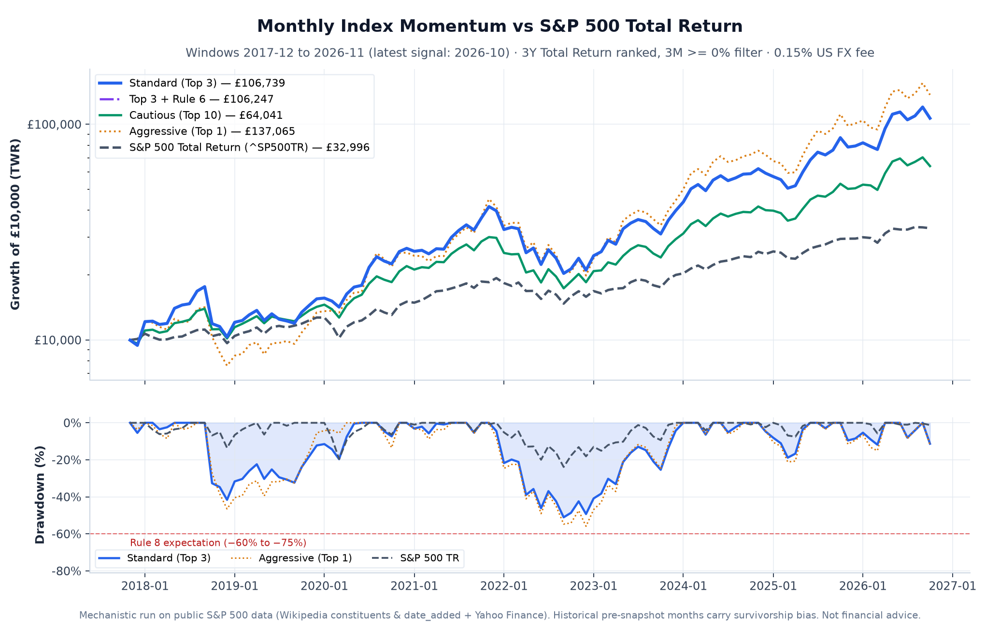

# Monthly Momentum

Mechanistic monthly index-constituent momentum strategy, public S&P 500 ranking & performance tracker, Rule 6 faded-winner monitor, and survivorship-bias-free backtester (`uv` Python).

> **Note:** This repository is for personal research, record-keeping, and tooling. Nothing here is financial advice.

<!-- AUTO-GENERATED:START -->

## Latest Mechanistic Picks — 2026-11 Window

Generated deterministically from completed monthly data through **2026-10** (`503` index members · `261` eligible after the 3-year history & non-negative 3-month return filter). Next trading day action: split this month's contribution equally across **Top 3**.

### Standard Strategy Picks (Top 3 — Equal 1/3 Split)

| Rank | Ticker | Company | Sector | 3Y Total Return | 3M Price Return |
| :---: | :--- | :--- | :--- | :---: | :---: |
| #1 | **LITE** | Lumentum | Information Technology | +2044.10% | +17.75% |
| #2 | **MU** | Micron Technology | Information Technology | +1235.84% | +7.50% |
| #3 | **CVNA** | Carvana | Consumer Discretionary | +1164.63% | +9.51% |

- **Aggressive (Top 1):** **LITE** (Lumentum) — `+2044.10%` 3Y TR, `+17.75%` 3M *(note: Top 1 historically saw drawdowns up to −76%)*.

<details>
<summary>Full Top 10 for 2026-11 (Cautious Variant & Rule 6 Watchlist)</summary>

| Rank | Ticker | Company | Sector | 3Y Total Return | 3M Price Return | Top 3 Buy |
| :---: | :--- | :--- | :--- | :---: | :---: | :---: |
| #1 | LITE | Lumentum | Information Technology | +2044.10% | +17.75% | Yes |
| #2 | MU | Micron Technology | Information Technology | +1235.84% | +7.50% | Yes |
| #3 | CVNA | Carvana | Consumer Discretionary | +1164.63% | +9.51% | Yes |
| #4 | PLTR | Palantir Technologies | Information Technology | +1143.99% | +49.61% | No |
| #5 | ECHO | EchoStar | Communication Services | +599.42% | +15.28% | No |
| #6 | DELL | Dell Technologies | Information Technology | +562.57% | +4.67% | No |
| #7 | CRWD | CrowdStrike | Information Technology | +466.68% | +31.21% | No |
| #8 | AMD | Advanced Micro Devices | Information Technology | +412.49% | +6.02% | No |
| #9 | NVDA | Nvidia | Information Technology | +403.31% | +1.94% | No |
| #10 | MRVL | Marvell Technology | Information Technology | +319.42% | +4.71% | No |

</details>

## Performance Chart (Mechanistic Simulation)



Monthly £500 DCA simulation across **108** windows (**2017-12** to **2026-11**, `£53,500` invested, `0.15%` US FX fee on buys/sells vs `0.00%` `^SP500TR` benchmark):

| Variant | Ending Value | XIRR | TWR CAGR | Max Drawdown | 5Y Rolling Win vs S&P 500 TR |
| :--- | :---: | :---: | :---: | :---: | :---: |
| Aggressive (Top 1) | £328,882 | 38.95% | 34.16% | -55.9% | 100.0% (48/48) |
| Standard (Top 3) | £236,239 | 31.84% | 30.45% | -51.0% | 100.0% (48/48) |
| Standard (Top 3 + Rule 6) | £235,167 | 31.74% | 30.38% | -51.0% | 100.0% (48/48) |
| Cautious (Top 10) | £166,740 | 24.42% | 23.18% | -42.1% | 100.0% (48/48) |
| Cautious (Top 10 + Rule 6) | £165,541 | 24.27% | 23.08% | -42.1% | 100.0% (48/48) |
| S&P 500 Total Return (`^SP500TR`) | £110,380 | 15.67% | 14.33% | -23.9% | Baseline |

> **Survivorship-Bias Note:** Backtest runs directly on the public dataset in `data/` (`data/constituents.csv` with Wikipedia `date_added` + accumulated monthly `data/constituent_snapshots.csv`). Historical pre-snapshot periods omit companies removed from the S&P 500 before snapshots began; forward monthly GitHub Action runs preserve exited constituents and build an exact point-in-time archive.

## Model Portfolio & Rule 6 Faded-Winner Status

- **Active model positions (Standard Top 3 + Rule 6):** `65` (tracked in [`data/model_holdings.csv`](data/model_holdings.csv)).
- **Rule 6 Exit Signals this month:** None triggered.

| Ticker | Company | Months Out of Top 10 | Status | Next Rule 6 Check |
| :--- | :--- | :---: | :--- | :---: |
| CME | CME Group | 94m | `rule6_stage2_sold` | 2027-01 |
| CSX | CSX Corporation | 88m | `rule6_stage2_sold` | 2027-07 |
| TTWO | Take-Two Interactive | 85m | `rule6_stage2_sold` | 2027-10 |
| BA | Boeing | 85m | `rule6_stage2_sold` | 2027-10 |
| ALGN | Align Technology | 83m | `rule6_stage1_sold` | 2026-12 |

## Mechanistic Stock Picks by Month / Window

Every monthly window below is computed mechanistically from `data/monthly_prices.csv` using the completed prior month's data (`data/rankings/history.csv`).

### Latest 12 Monthly Windows

| Window | Signal Data | Top 3 (Standard Equal Split) | Top 1 (Aggressive) | Ranks 4–10 (Rule 6 Watchlist) | Eligible |
| :--- | :--- | :--- | :--- | :--- | :---: |
| 2026-11 | 2026-10 | **LITE** (+2044%), **MU** (+1236%), **CVNA** (+1165%) | LITE | PLTR, ECHO, DELL, CRWD, AMD, NVDA, MRVL | 261 |
| 2026-10 | 2026-09 | **LITE** (+2050%), **PLTR** (+1069%), **HOOD** (+1047%) | LITE | DELL, CRWD, AMD, NVDA, ANET, HPE, P | 186 |
| 2026-09 | 2026-08 | **LITE** (+1590%), **PLTR** (+1144%), **HOOD** (+862%) | LITE | DELL, CVNA, CRWD, NVDA, IBKR, ANET, BNY | 303 |
| 2026-08 | 2026-07 | **WDC** (+1601%), **STX** (+1345%), **MU** (+1066%) | WDC | DELL, HOOD, HWM, FLEX, CRWD, ANET, NVDA | 300 |
| 2026-07 | 2026-06 | **WDC** (+2138%), **APP** (+1902%), **MU** (+1753%) | WDC | STX, LITE, VRT, CVNA, FIX, CIEN, HOOD | 320 |
| 2026-06 | 2026-05 | **CVNA** (+2725%), **APP** (+2351%), **WDC** (+1722%) | CVNA | VRT, LITE, STX, MU, FIX, CIEN, PLTR | 196 |
| 2026-05 | 2026-04 | **VRT** (+2109%), **LITE** (+1770%), **WDC** (+1576%) | VRT | FIX, STX, CIEN, COHR, MU, ECHO, NVDA | 247 |
| 2026-04 | 2026-03 | **VRT** (+1657%), **LITE** (+1201%), **FIX** (+855%) | VRT | WDC, CIEN, STX, ECHO, COHR, MU, HWM | 225 |
| 2026-03 | 2026-02 | **FIX** (+895%), **WDC** (+865%), **NVDA** (+664%) | FIX | MU, CIEN, STX, HWM, NRG, GE, LRCX | 323 |
| 2026-02 | 2026-01 | **CVNA** (+3844%), **FIX** (+855%), **WDC** (+656%) | CVNA | MU, STX, HWM, RCL, EME, META, LRCX | 322 |
| 2026-01 | 2025-12 | **CVNA** (+8803%), **FIX** (+721%), **WDC** (+625%) | CVNA | AVGO, GE, MU, STX, HWM, LRCX, CEG | 225 |
| 2025-12 | 2025-11 | **APP** (+4060%), **PLTR** (+2146%), **HOOD** (+1240%) | APP | NVDA, AVGO, WDC, STX, GE, HWM, CRWD | 239 |

<details>
<summary>Full Monthly Pick History (108 windows: 2017-12 to 2026-11)</summary>

| Window | Signal Data | Top 3 (Standard) | Top 1 | Ranks 4–10 | Eligible |
| :--- | :--- | :--- | :--- | :--- | :---: |
| 2026-11 | 2026-10 | LITE, MU, CVNA | LITE | PLTR, ECHO, DELL, CRWD, AMD, NVDA, MRVL | 261 |
| 2026-10 | 2026-09 | LITE, PLTR, HOOD | LITE | DELL, CRWD, AMD, NVDA, ANET, HPE, P | 186 |
| 2026-09 | 2026-08 | LITE, PLTR, HOOD | LITE | DELL, CVNA, CRWD, NVDA, IBKR, ANET, BNY | 303 |
| 2026-08 | 2026-07 | WDC, STX, MU | WDC | DELL, HOOD, HWM, FLEX, CRWD, ANET, NVDA | 300 |
| 2026-07 | 2026-06 | WDC, APP, MU | WDC | STX, LITE, VRT, CVNA, FIX, CIEN, HOOD | 320 |
| 2026-06 | 2026-05 | CVNA, APP, WDC | CVNA | VRT, LITE, STX, MU, FIX, CIEN, PLTR | 196 |
| 2026-05 | 2026-04 | VRT, LITE, WDC | VRT | FIX, STX, CIEN, COHR, MU, ECHO, NVDA | 247 |
| 2026-04 | 2026-03 | VRT, LITE, FIX | VRT | WDC, CIEN, STX, ECHO, COHR, MU, HWM | 225 |
| 2026-03 | 2026-02 | FIX, WDC, NVDA | FIX | MU, CIEN, STX, HWM, NRG, GE, LRCX | 323 |
| 2026-02 | 2026-01 | CVNA, FIX, WDC | CVNA | MU, STX, HWM, RCL, EME, META, LRCX | 322 |
| 2026-01 | 2025-12 | CVNA, FIX, WDC | CVNA | AVGO, GE, MU, STX, HWM, LRCX, CEG | 225 |
| 2025-12 | 2025-11 | APP, PLTR, HOOD | APP | NVDA, AVGO, WDC, STX, GE, HWM, CRWD | 239 |
| 2025-11 | 2025-10 | APP, PLTR, NVDA | APP | HOOD, AVGO, GE, HWM, DASH, WDC, STX | 250 |
| 2025-10 | 2025-09 | APP, PLTR, NVDA | APP | HOOD, VST, RCL, GE, AVGO, HWM, EME | 296 |
| 2025-09 | 2025-08 | PLTR, NVDA, RCL | PLTR | VST, SMCI, AVGO, GE, NFLX, HWM, COIN | 321 |
| 2025-08 | 2025-07 | PLTR, SMCI, NVDA | PLTR | VST, RCL, AXON, COIN, GE, AVGO, CEG | 316 |
| 2025-07 | 2025-06 | PLTR, SMCI, NVDA | PLTR | RCL, VST, AXON, NFLX, COIN, GE, AVGO | 272 |
| 2025-06 | 2025-05 | PLTR, AXON, NVDA | PLTR | VST, NFLX, GE, CEG, HWM, RCL, AVGO | 191 |
| 2025-05 | 2025-04 | PLTR, SMCI, NFLX | PLTR | FICO, HWM, NRG, LLY, TKO, TT, PGR | 156 |
| 2025-04 | 2025-03 | SMCI, PLTR, HWM | SMCI | GE, TPL, LLY, TRGP, NRG, CAH, TKO | 216 |
| 2025-03 | 2025-02 | SMCI, PLTR, HWM | SMCI | LLY, AVGO, GE, META, NRG, RCL, PGR | 164 |
| 2025-02 | 2025-01 | VST, CEG, PLTR | VST | AXON, HWM, AVGO, TPL, ANET, TRGP, GE | 262 |
| 2025-01 | 2024-12 | VST, FICO, NVDA | VST | PLTR, AXON, AVGO, TRGP, HWM, DECK, ANET | 193 |
| 2024-12 | 2024-11 | VST, FICO, HWM | VST | NVDA, TRGP, TPL, AXON, RCL, ANET, PLTR | 319 |
| 2024-11 | 2024-10 | VST, NVDA, FICO | VST | ANET, AVGO, HWM, LLY, TRGP, IRM, GE | 280 |
| 2024-10 | 2024-09 | VST, FICO, ANET | VST | AVGO, HWM, PHM, TRGP, ERIE, IRM, GE | 358 |
| 2024-09 | 2024-08 | NVDA, LLY, ANET | NVDA | FICO, TRGP, AVGO, MPC, HWM, ACGL, IRM | 340 |
| 2024-08 | 2024-07 | NVDA, VST, ANET | NVDA | AVGO, TRGP, LLY, MCK, FANG, FICO, HWM | 339 |
| 2024-07 | 2024-06 | NVDA, VST, LLY | NVDA | ANET, AVGO, MCK, TRGP, FICO, PANW, KLAC | 191 |
| 2024-06 | 2024-05 | NVDA, VST, LLY | NVDA | FSLR, ANET, DECK, TRGP, MPC, AVGO, MCK | 265 |
| 2024-05 | 2024-04 | SMCI, NVDA, LLY | SMCI | MPC, TRGP, AVGO, MCK, FANG, COP, PWR | 279 |
| 2024-04 | 2024-03 | SMCI, NVDA, LLY | SMCI | MPC, ANET, TRGP, FANG, AVGO, STLD, PWR | 339 |
| 2024-03 | 2024-02 | NVDA, ANET, LLY | NVDA | STLD, JBL, NUE, TRGP, MPC, MCK, FANG | 353 |
| 2024-02 | 2024-01 | NVDA, MPC, NUE | NVDA | STLD, ANET, TRGP, LLY, JBL, IT, MCK | 396 |
| 2024-01 | 2023-12 | NVDA, FANG, LLY | NVDA | TRGP, NUE, STLD, ANET, JBL, PWR, IT | 382 |
| 2023-12 | 2023-11 | FANG, LLY, MPC | FANG | TRGP, STLD, ANET, PANW, IT, IRM, MCK | 229 |
| 2023-11 | 2023-10 | FANG, MPC, TRGP | FANG | COP, LLY, ANET, HAL, MCK, EQT, ACGL | 67 |
| 2023-10 | 2023-09 | OXY, TRGP, FANG | OXY | MPC, APA, EOG, COP, XOM, SLB, LLY | 134 |
| 2023-09 | 2023-08 | DVN, TRGP, OXY | DVN | ON, MPC, FANG, PWR, NUE, LLY, STLD | 331 |
| 2023-08 | 2023-07 | DVN, ON, PWR | DVN | TRGP, NVDA, NUE, FANG, STLD, OXY, MPC | 308 |
| 2023-07 | 2023-06 | PWR, ON, NVDA | PWR | NUE, TRGP, TSLA, EQT, PANW, HCA, HWM | 275 |
| 2023-06 | 2023-05 | ON, PWR, FSLR | ON | NVDA, HWM, AVGO, LLY, ANET, IT, EQT | 162 |
| 2023-05 | 2023-04 | TRGP, PWR, FSLR | TRGP | NVDA, HWM, ACGL, XOM, FTNT, ANET, AJG | 171 |
| 2023-04 | 2023-03 | ON, MPC, FCX | ON | FSLR, TSLA, STLD, PWR, NUE, MOS, NVDA | 244 |
| 2023-03 | 2023-02 | STLD, TSLA, NUE | STLD | PWR, FCX, ON, URI, NVDA, MOS, MPWR | 159 |
| 2023-02 | 2023-01 | MRNA, STLD, FCX | MRNA | PWR, NUE, ALB, FSLR, NVDA, URI, ON | 334 |
| 2023-01 | 2022-12 | MRNA, PWR, STLD | MRNA | FCX, LLY, DVN, MCK, FSLR, DE, ON | 360 |
| 2022-12 | 2022-11 | MRNA, ALB, PWR | MRNA | FCX, ON, LLY, NVDA, NUE, ANET, DE | 310 |
| 2022-11 | 2022-10 | ALB, DVN, PWR | ALB | LLY, FCX, DXCM, MCK, MOS, COP, CF | 164 |
| 2022-10 | 2022-09 | TSLA, ALB, PWR | TSLA | ON, DVN, MCK, AAPL, REGN, CDNS, MOS | 129 |
| 2022-09 | 2022-08 | TSLA, ALB, PWR | TSLA | ON, AAPL, MPWR, NUE, MCK, CDNS, ODFL | 119 |
| 2022-08 | 2022-07 | TSLA, MRNA, PWR | TSLA | FTNT, GNRC, ALB, MPWR, LLY, AAPL, ON | 209 |
| 2022-07 | 2022-06 | LLY, MCK, UNH | LLY | AZO, BMY, DG, TMUS, HUM, CI, WRB | 42 |
| 2022-06 | 2022-05 | ALB, KLAC, PWR | ALB | DVN, MOS, NUE, LLY, MCK, SNPS, CF | 169 |
| 2022-05 | 2022-04 | FCX, TGT, NUE | FCX | PWR, MCK, LLY, NEM, MOS, COR, DE | 148 |
| 2022-04 | 2022-03 | TSLA, FCX, PWR | TSLA | URI, NUE, CF, DE, MCK, MOS, BRO | 162 |
| 2022-03 | 2022-02 | FTNT, FCX, HWM | FTNT | STX, AMP, AVGO, GEN, NUE, BRO, DVN | 204 |
| 2022-02 | 2022-01 | AAPL, KLAC, QCOM | AAPL | AMAT, LRCX, STX, TSCO, LOW, AMP, BRO | 197 |
| 2022-01 | 2021-12 | TSLA, NVDA, AMD | TSLA | LRCX, TER, FTNT, KLAC, AMAT, WST, AAPL | 338 |
| 2021-12 | 2021-11 | TSLA, NVDA, AMD | TSLA | LRCX, FTNT, KLAC, TER, DXCM, MPWR, AMAT | 177 |
| 2021-11 | 2021-10 | TSLA, GNRC, AMD | TSLA | NVDA, DXCM, MPWR, MSCI, KLAC, WST, FTNT | 255 |
| 2021-10 | 2021-09 | TSLA, CMG, MPWR | TSLA | DXCM, MSCI, KLAC, WST, PWR, CDNS, AMD | 200 |
| 2021-09 | 2021-08 | TSLA, GNRC, AMD | TSLA | CMG, WST, FTNT, DXCM, MSCI, CRL, CDNS | 251 |
| 2021-08 | 2021-07 | GNRC, AMD, DXCM | GNRC | FTNT, CMG, ZBRA, WST, MSCI, LRCX, TGT | 252 |
| 2021-07 | 2021-06 | TSLA, GNRC, AMD | TSLA | DXCM, LRCX, FTNT, ZBRA, WST, CMG, TER | 314 |
| 2021-06 | 2021-05 | WST, FTNT, TER | WST | LRCX, TGT, PYPL, CRL, KLAC, MSCI, TT | 377 |
| 2021-05 | 2021-04 | GNRC, DXCM, TER | GNRC | WST, FTNT, ZBRA, LRCX, CMG, PYPL, MSCI | 372 |
| 2021-04 | 2021-03 | GNRC, CMG, CDNS | GNRC | ZBRA, FTNT, KLAC, PYPL, LRCX, TGT, TSCO | 325 |
| 2021-03 | 2021-02 | TSLA, DXCM, CMG | TSLA | CDNS, ZBRA, FTNT, MPWR, PYPL, WST, LRCX | 267 |
| 2021-02 | 2021-01 | TSLA, DXCM, AMD | TSLA | CMG, NOW, AAPL, ZBRA, FTNT, KEYS, WST | 352 |
| 2021-01 | 2020-12 | TSLA, AMD, CMG | TSLA | NOW, ZBRA, MSCI, FTNT, CDNS, AAPL, IDXX | 349 |
| 2020-12 | 2020-11 | AMD, NOW, ZBRA | AMD | MSCI, TGT, IDXX, PYPL, TER, KEYS, NVDA | 311 |
| 2020-11 | 2020-10 | CMG, NOW, CPRT | CMG | TGT, WST, QCOM, AAPL, DG, IDXX, ADBE | 208 |
| 2020-10 | 2020-09 | DXCM, AMD, NOW | DXCM | CMG, ADBE, AMZN, MSCI, AAPL, PYPL, CPRT | 296 |
| 2020-09 | 2020-08 | AMD, DXCM, NOW | AMD | CMG, AMZN, MSCI, WST, PYPL, ADBE, AAPL | 311 |
| 2020-08 | 2020-07 | DXCM, AMD, NOW | DXCM | FTNT, MSCI, CMG, PYPL, AMZN, WST, ADBE | 318 |
| 2020-07 | 2020-06 | DXCM, AMD, NOW | DXCM | FTNT, MSCI, PYPL, MSFT, ADBE, NFLX, CDNS | 365 |
| 2020-06 | 2020-05 | DXCM, AMD, NOW | DXCM | FTNT, MSCI, PYPL, ODFL, CPRT, KEYS, MSFT | 190 |
| 2020-05 | 2020-04 | AMD, NOW, MSCI | AMD | NVDA, NFLX, MSFT, AMZN, ADBE, KEYS, PYPL | 60 |
| 2020-04 | 2020-03 | NOW, MSCI, NFLX | NOW | MSFT, NVDA, ODFL, SBAC, AMZN, VRTX, PGR | 28 |
| 2020-03 | 2020-02 | NOW, MSCI, AMD | NOW | ADBE, NVDA, MSFT, LRCX, NFLX, ZTS, VRTX | 78 |
| 2020-02 | 2020-01 | AMD, NOW, TDG | AMD | MSCI, CPRT, FTNT, ADBE, MA, PYPL, ZBRA | 276 |
| 2020-01 | 2019-12 | AMD, NOW, FTNT | AMD | MSCI, NRG, CPRT, ADBE, ZBRA, VRTX, MA | 289 |
| 2019-12 | 2019-11 | AMD, NRG, FTNT | AMD | MSCI, NOW, CPRT, ADBE, ALGN, EW, MA | 284 |
| 2019-11 | 2019-10 | AMD, NRG, CPRT | AMD | KEYS, MSCI, LRCX, CDW, ALGN, NVDA, MU | 225 |
| 2019-10 | 2019-09 | NRG, BA, KEYS | NRG | CPRT, CDW, TTWO, MA, LRCX, NVDA, MSFT | 238 |
| 2019-09 | 2019-08 | AMD, KEYS, NRG | AMD | TTWO, BA, MA, CPRT, ADBE, NVDA, MU | 295 |
| 2019-08 | 2019-07 | AMD, MU, CPRT | AMD | CDNS, KEYS, ADBE, TTWO, IDXX, MA, MSCI | 241 |
| 2019-07 | 2019-06 | AMD, NFLX, MSCI | AMD | PYPL, CSX, KEYS, ADBE, MA, CPRT, ADSK | 258 |
| 2019-06 | 2019-05 | AMD, ALGN, CSX | AMD | PYPL, CPRT, MSCI, IDXX, DHR, TTWO, ADBE | 179 |
| 2019-05 | 2019-04 | AMD, NVDA, ANET | AMD | ALGN, NFLX, MU, KEYS, NTAP, CPRT, MSCI | 310 |
| 2019-04 | 2019-03 | AMD, NVDA, ANET | AMD | MU, ALGN, NFLX, NRG, BA, KEYS, CSX | 356 |
| 2019-03 | 2019-02 | AMD, ANET, BA | AMD | NRG, ALGN, MU, NFLX, KEYS, CSX, ADSK | 260 |
| 2019-02 | 2019-01 | AMD, NRG, ALGN | AMD | NFLX, BA, MU, KEYS, ADSK, IDXX, CPRT | 238 |
| 2019-01 | 2018-12 | NRG, CME, NEM | NRG | AVGO, YUM, NEE, EXC, CNP, AMT, MKC | 56 |
| 2018-12 | 2018-11 | NRG, UNH, BA | NRG | ROL, DHR, ELV, CME, HCA, DE, BSX | 142 |
| 2018-11 | 2018-10 | TTWO, ISRG, NRG | TTWO | ADBE, NTAP, FTNT, ADSK, PYPL, UNH, ROL | 134 |
| 2018-10 | 2018-09 | AMD, NVDA, ALGN | AMD | TTWO, ANET, AMZN, ISRG, ADSK, IDXX, ADBE | 280 |
| 2018-09 | 2018-08 | AMD, NVDA, ALGN | AMD | TTWO, ANET, AMZN, CPRT, IDXX, ADBE, ADSK | 280 |
| 2018-08 | 2018-07 | NVDA, AMD, ALGN | NVDA | TTWO, IDXX, AMZN, CPRT, ADBE, NFLX, ISRG | 278 |
| 2018-07 | 2018-06 | NVDA, AMD, ALGN | NVDA | TTWO, NFLX, AMZN, IDXX, ADBE, ISRG, MSCI | 212 |
| 2018-06 | 2018-05 | NVDA, AMD, ALGN | NVDA | TTWO, NFLX, AMZN, ADBE, IDXX, ISRG, MSCI | 182 |
| 2018-05 | 2018-04 | NFLX, AMZN, IDXX | NFLX | ADBE, ISRG, MSCI, BBY, PGR, GPN, ADSK | 104 |
| 2018-04 | 2018-03 | NVDA, NFLX, ALGN | NVDA | AMZN, LRCX, ADBE, AMAT, IDXX, ISRG, GPN | 150 |
| 2018-03 | 2018-02 | NVDA, ALGN, NFLX | NVDA | AMZN, AMD, ADBE, BA, ISRG, GPN, AMAT | 200 |
| 2018-02 | 2018-01 | NVDA, AMD, ALGN | NVDA | NFLX, AMZN, ADBE, BA, ISRG, DHR, GPN | 301 |
| 2018-01 | 2017-12 | NVDA, ALGN, NFLX | NVDA | AMZN, AVGO, GPN, BA, ADBE, STZ, AVY | 285 |
| 2017-12 | 2017-11 | NVDA, ALGN, NFLX | NVDA | AMZN, AVGO, AVY, ADBE, UNH, AOS, LRCX | 299 |

</details>

<!-- AUTO-GENERATED:END -->

## Monthly Workflow Summary

1. **When:** On the first trading day of each month, invest that month's contribution (plus any Rule 6/7 cash).
2. **Universe & Ranking:** Start from current constituents of a major index (S&P 500 is the most thoroughly tested), rank by 3-year total return including dividends, and exclude any share below its price 3 months ago.
3. **Selection:** Split that month's money equally across the top 3 (even if you already hold them). Record the top 10 if tracking the optional Rule 6 exit.
4. **Hold Discipline:** Never sell because a share has fallen — every tested stop-loss hurt performance.
5. **Optional Staged Exit (Rule 6):** If a holding stays outside the top 10 for 6 years, sell 1/3; at 7 years, sell 1/2 of the remainder; at 8 years, sell the rest (stop selling if it returns to the top 10).

See [docs/rules.md](docs/rules.md) for the complete rules, tested variants, rejected rules, free screener options, simplifications, and backtesting data requirements.

## Quickstart & CLI Usage

Requires [`uv`](https://docs.astral.sh/uv/):

```bash
uv sync
```

### Public Dataset, Chart & README Refresh

```bash
# Fetch S&P 500 constituents (Wikipedia) + 12y completed monthly prices (Yahoo Finance),
# recompute all windows, regenerate assets/performance.png, and update README.md:
uv run monthly-momentum refresh

# Rebuild rankings, model holdings, chart, and README deterministically offline from data/:
uv run monthly-momentum report
```

### Monthly ISA Execution & Personal Holdings

```bash
# Optional: initialize gitignored personal ISA tracker (data/private/holdings.csv)
uv run monthly-momentum init

# Plan this month's £500 ISA buys from committed public picks (dry run)
uv run monthly-momentum run --use-public --contribution 500 --currency GBP --market us

# Or rank a manual Finviz / Market Chameleon CSV export
uv run monthly-momentum rank path/to/screener.csv --month 2026-11 --output data/private/rank.csv

# Apply buys & top-10 tracking to your personal holdings sheet
uv run monthly-momentum run --use-public --contribution 500 --apply

# Check Rule 6 status across personal holdings
uv run monthly-momentum holdings check --ranking data/rankings/latest.csv
```

### Backtesting & Variant Comparison

```bash
# Compare Top 1, Top 3, Top 3 + Rule 6, Top 10, Top 10 + Rule 6 on committed public data:
uv run monthly-momentum compare --signal-mode next_month

# Run an external survivorship-bias-free dataset (e.g. Norgate or EODHD):
uv run monthly-momentum backtest \
  --prices path/to/prices.csv \
  --constituents path/to/constituents.csv \
  --events path/to/events.csv \
  --variant standard --rule6
```

## Automated Monthly GitHub Action

[`.github/workflows/monthly-refresh.yml`](.github/workflows/monthly-refresh.yml) runs automatically on the **1st of every month at 08:00 UTC** (and on manual `workflow_dispatch`):

1. Runs `uv run monthly-momentum refresh` to fetch the latest Wikipedia S&P 500 constituents and completed monthly prices from Yahoo Finance.
2. Appends the new month's point-in-time constituent roster to `data/constituent_snapshots.csv` and merges new bars into `data/monthly_prices.csv` (preserving price history of any stocks that exit the index).
3. Verifies offline reproducibility via `uv run monthly-momentum report` and commits any updated files under `data/`, `assets/`, and `README.md`.

## Repository Layout

| Path | Purpose | Tracked in Git |
| :--- | :--- | :---: |
| [src/monthly_momentum/](src/monthly_momentum/) | Python package (`cli`, `live`, `ranking`, `holdings`, `planner`, `backtest`, `chart`, `report`, `refresh`) | Yes |
| [tests/](tests/) | Offline pytest unit & integration suite | Yes |
| [docs/rules.md](docs/rules.md) | Full strategy specification, rejected rules, and data sources | Yes |
| [data/constituents.csv](data/constituents.csv) | Current S&P 500 constituents and Wikipedia `date_added` | Yes |
| [data/constituent_snapshots.csv](data/constituent_snapshots.csv) | Monthly point-in-time constituent roster archive | Yes |
| [data/monthly_prices.csv](data/monthly_prices.csv) | Completed monthly `close` & `adj_close` bars + `^SP500TR` | Yes |
| [data/rankings/](data/rankings/) | Mechanistic `latest.csv` and full `history.csv` Top 10 snapshots | Yes |
| [data/model_holdings.csv](data/model_holdings.csv) | Mechanistic Rule 6 tracking sheet for model Top 3 portfolio | Yes |
| [data/performance.csv](data/performance.csv) & [data/summary.json](data/summary.json) | Variant equity series & summary metrics | Yes |
| [assets/performance.png](assets/performance.png) | Generated performance & drawdown chart | Yes |
| [templates/](templates/) | Header-only CSV templates for rankings, holdings, and backtest inputs | Yes |
| [`.github/workflows/`](.github/workflows/) | Monthly data refresh workflow and CI test/lint workflow | Yes |
| `data/private/`, `data/raw/`, `records/`, `portfolio/` | Optional personal ISA logs & local screener dumps | No (gitignored) |
