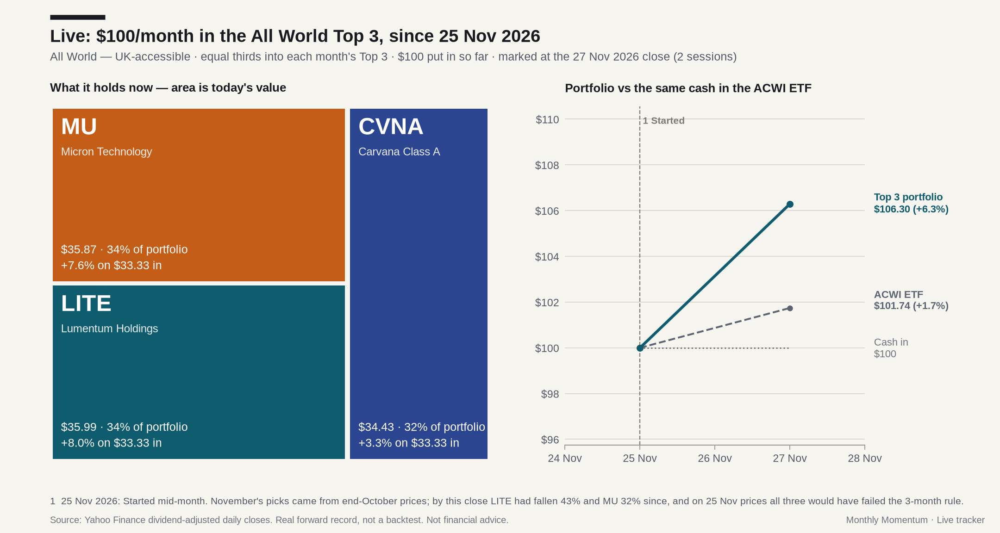

# Monthly Momentum

Each month, buy equal amounts of the three shares with the best 3-year total return, skipping any that fell over the last 3 months. Hold them; never sell on a falling price.

Picks, data and charts refresh automatically on the 1st of each month. Not financial advice.

<!-- AUTO-GENERATED:START -->

## This month's picks

**Latest window:** 2026-11.
**Last updated:** 2026-11-25 (UTC).

| Universe | Window | Top 3 |
| :--- | :--- | :--- |
| All World — UK-accessible | 2026-11 | **LITE**, **MU**, **CVNA** |
| US S&P 500 | 2026-11 | **LITE**, **MU**, **CVNA** |
| UK FTSE 100 | 2026-11 | **BGEO.L**, **PCT.L**, **SMT.L** |
| All World — Full ACWI | 2026-11 | **LITE**, **2059.TW**, **MU** |

[Rankings and returns](docs/report.md#latest-pick-details) · New picks are published as [GitHub releases](../../releases) on the 1st.

## Live portfolio



The real portfolio, tracked forward from 25 Nov 2026: `$100` a month split equally across the All World — UK-accessible Top 3, against the same cash in the ACWI ETF. Updated after every US market close.

## Backtests

`$100` a month into the Top 3, held without stop-losses:

| Universe | 2017–2026 | 2006–2026 | Worst drop |
| :--- | ---: | ---: | ---: |
| **All World — UK-accessible** (997 stocks) | $44,025 (29.8%/yr) | — | -47% |
| **US S&P 500** (663 stocks, incl. delisted) | $45,536 (30.5%/yr) | $373,874 (21.9%/yr) | -66% |
| All World — full ACWI (2140 stocks) | $38,941 (27.2%/yr) | — | -41% |
| UK FTSE 100 (100 stocks, GBP) | £18,339 (11.7%/yr) | — | -38% |
| *S&P 500 tracker* | $22,416 (15.6%/yr) | $121,970 (13.4%/yr) | — |
| *ACWI ETF* | $19,959 (13.2%/yr) | — | — |


Returns come from a few multi-baggers held through deep falls, so the five largest holdings end up at 71–77% of the portfolio.

## Rules

1. Rank the universe by 3-year total return (dividends included), using prices to the end of the previous month.
2. Drop anything trading below its price of three months ago.
3. On the first trading day, split the month's deposit equally across the top 3. Names already held are bought again.
4. Never sell on a falling price. Takeover cash goes into the next month's buys.
5. Optional staged exit: after 6 years outside the top 10 sell a third, at 7 years half the rest, at 8 years the remainder.

Details: [rules](docs/rules.md) · [research](docs/research.md) · [full report with rankings, variants and history](docs/report.md)

<!-- AUTO-GENERATED:END -->

## Usage

Requires [`uv`](https://docs.astral.sh/uv/).

```bash
uv sync
uv run monthly-momentum run --use-public --contribution 500 --currency GBP   # plan this month's buys
uv run monthly-momentum refresh --with-global                                # fetch data, rebuild everything
uv run monthly-momentum report                                               # rebuild offline from data/
uv run monthly-momentum track                                                # update the live portfolio
uv run monthly-momentum compare --signal-mode next_month                     # Top 1/3/5/10 side by side
```

Run `uv run monthly-momentum --help` for the rest (personal holdings, lump sums, exclusions).

## Automation

- [Monthly refresh](.github/workflows/monthly-refresh.yml): 08:00 UTC on the 1st. Fetches data, regenerates rankings, charts, this README and [docs/report.md](docs/report.md), and publishes a release.
- [Live tracker](.github/workflows/live-tracker.yml): 22:30 UTC on weekdays. Marks the live portfolio to the latest close.

Data sources and file layout are described in [data/README.md](data/README.md).
